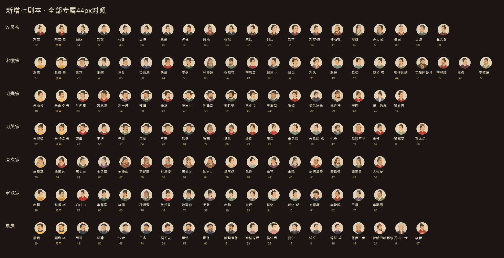

# 新增七剧本专属像补全 · 验收

2026-11-10，分支 `codex/important-portraits`，[草稿 PR #11](https://github.com/Lynch715/yuji-emperor/pull/11)。**未合并、未发布。** 本文是“继续做完”的最终验收；[首批24人记录](ART-IMPORTANT-QA.md)保留为阶段记录。

## 最终范围

七个新增剧本明列的121位开局历史人物全部能取本人专属。六帝有本人老年续玩档；唐玄宗开局70岁，用同一老年开局像。五个未成年皇嗣有成年档，共132个显示档位。皇嗣到16岁切换，赵构成年沿用另一剧本19岁的本人。随机补齐的官员仍走原池。

本轮新画97个WebP；加首批29张，本PR累计新增126张。全库516个WebP（503张原画＋13张场景派生），总计6,231,438字节／5.94MiB。本轮97图872,586字节，最大16,354字节。

| 剧本 | 开局人物 | 含老年／成年档 | 本轮新图 | 对照 |
| --- | ---: | ---: | ---: | --- |
| 汉灵帝 | 18 | 20 | 14 | [人物与44px](art-complete-review/han-lingdi-contact.png) · [原尺寸条](art-complete-review/han-lingdi-44px.png) |
| 宋徽宗 | 20 | 22 | 16 | [人物与44px](art-complete-review/song-huizong-contact.png) · [原尺寸条](art-complete-review/song-huizong-44px.png) |
| 明熹宗 | 17 | 18 | 13 | [人物与44px](art-complete-review/ming-xizong-contact.png) · [原尺寸条](art-complete-review/ming-xizong-44px.png) |
| 明英宗 | 17 | 19 | 14 | [人物与44px](art-complete-review/ming-yingzong-contact.png) · [原尺寸条](art-complete-review/ming-yingzong-44px.png) |
| 唐玄宗 | 17 | 17 | 14 | [人物与44px](art-complete-review/tang-xuanzong-contact.png) · [原尺寸条](art-complete-review/tang-xuanzong-44px.png) |
| 宋钦宗 | 15 | 17 | 11 | [人物与44px](art-complete-review/song-qinzong-contact.png) · [原尺寸条](art-complete-review/song-qinzong-44px.png) |
| 嘉庆 | 17 | 19 | 15 | [人物与44px](art-complete-review/qing-jiaqing-contact.png) · [原尺寸条](art-complete-review/qing-jiaqing-44px.png) |

明确复用：魏忠贤、林丹汗沿用既有本人专属；两宋李纲、李乾顺、李乾德跨局共享本人；赵构12岁另画，成年复用宋钦宗局19岁本人。同姓不同人的周氏、刘氏不共享。宋徽宗局19岁赵桓另画皇子服，不借26岁皇帝像的龙袍。相邻成年年龄共享不表示实际年龄被改写。

## 生成、年龄与辨识

每张专属单独调用内置imagegen，参照一期完整四图板＋本朝完整四图板；长大、变老或跨局同人另外传本人图。所有长相卡、提示词与返工记录在[ART-PROMPTS](ART-PROMPTS.md)。每剧本逐一拼44px条目检；[长相卡文字维度核对](art-complete-review/card-audit.json)覆盖121人，最少5维描述不同，文字核对不替代视觉验收。

末检修正：刘辩与朱见深按2岁幼童，绵恺4岁；黎邦基8岁、黎维祺14岁、王楷17岁保持男童／少年。赵构19岁、旻宁17岁去掉成年胡须或灰鬓；年轻后妃去掉误带额纹。曹鼐改宽圆方脸与贴面短络腮，左光斗改宽短脸和单横短髭，李璘改高颧削瘦脸与细短山羊须，分别与于谦、杨涟、李亨拉开。宋刘贵妃与郑皇后、张叔夜与李纲也加强脸型、胡须差异。

熊廷弼经略、王化贞巡抚用明制文官冠服；高仙芝按武将甲胄。德川秀忠用江户礼服，保罗一世／乔治三世用18世纪欧洲礼服，朝鲜／越南等按本国冠服。范围扩展及外邦服饰解释已在生成前写进PR。游戏没有外邦年龄字段，数值仅作美术估龄／年代参照，不写回核心。脸型、痣和具体容貌属于美术设计，不声称是史实肖像；成年／老年续玩档也不声称人物实际活到该年龄。

PNG原稿、未选稿及参照板留在本机忽略目录（本轮128个原稿／返工PNG已归档至项目的 `art-source/complete-20261110/`，未进入Git）；仅裁切、等比缩放及q75转WebP，不程序修脸、补画或调色。最终97张全部400×500、≤30KB，眼线36.004–39.999%，完整头冠顶10.007–14.000%。[逐张读数与来源](art-complete-review/asset-checks.json)。

## 回归与旧档

- `npm test` **649／649**；覆盖121人专属、随机补员取池、五位皇嗣15／16岁切换、明确同人共享、同姓异人不共享及取图不修改状态。已有旧存档迁移、待续和提交幂等回归全部通过。首轮一条旧验收仍把外邦国名当成君主名，已按正式取图的 `ruler || name` 修正测试筛选并全量重跑。[测试结果](art-complete-review/test-results.json)。
- `npm run build`与`git diff --check`通过；106模块，882,011字节脚本。
- 宋徽宗固定种子“七局专属补全200年”：**200年／7200旬**，7朝、6次继位，无模型调用、未崩溃。[模拟结果](art-complete-review/simulation-200y.json)。
- 不改核心、LLM、CSS、存档v26、池与取图函数，只追加专属映射。[核心／LLM／CSS逐文件不变证据](art-complete-review/source-invariants.json)。首批[14局完整状态散列](art-important-review/core-unchanged.json)仍适用；本轮未将其冒称重新跑出的状态审计。
- 本轮前419个WebP与`019b56d`逐字节一致，包含main原390图；[全部SHA-256与字节数](art-complete-review/integrity.json)。

## 浏览器、缺图与可访问性

功能与截图用新版Codex In-app Browser，localhost 4240。沿用首批的本地明英宗空卷试读，只查看界面，未推进旬、未调用模型，也未操作正式站或私人存档。实测新补张辅召见纸面、周氏召见像、朱见深宗室卡、黎邦基外交纸面均加载本人400×500图；正常游戏console warn／error为空。

只读图册使用正式 `portraitHTML`、`initArt` 和原CSS，不读写游戏进度。132档×圆章／人物卡／纸面＝396实例，全部正常加载；1280／768／390及额外360宽无横向溢出。桌面纸面200×250，390宽为120×150，行动浮层头图325×112，裁切未露边。

| 验收画面 | 截图 |
| --- | --- |
| 实际召见 | [张辅1280](art-complete-review/game-zhangfu-1280.jpg) · [张辅390](art-complete-review/game-zhangfu-390.jpg) |
| 实际后妃／宗室／外交 | [周氏390](art-complete-review/game-zhou-390.jpg) · [朱见深390](art-complete-review/game-child-390.jpg) · [黎邦基390](art-complete-review/game-foreign-390.jpg) |
| 图册三档 | [1280](art-complete-review/gallery-1280.jpg) · [768](art-complete-review/gallery-768.jpg) · [390](art-complete-review/gallery-390.jpg) |
| 关闭插图 | [396实例退回44px圆章](art-complete-review/fallback-off-360.jpg) |
| 404／图片服务不可达 | [404](art-complete-review/fallback-missing-360.jpg) · [停止服务后](art-complete-review/fallback-unreachable-360.jpg) |

关闭插图后396图隐藏、396个实例均44px圆章。404与停止本地图片服务分别使用不同请求参数，均退回“刘”圆章；保留已加载文档时页面仍可操作。这里验证图片请求失败，不声称断网后能刷新整站。服务及开关恢复后396／396再次加载正常，窗口恢复默认大小。[完整DOM证据](art-complete-review/browser-checks.json)。

实际召见纸面正文对比度12.34:1，[样式读数](art-complete-review/contrast.json)；CSS逐字节不改。官方Lighthouse13.6.0独立headless可访问性审计100分、无失败项，功能浏览器仍为应用内浏览器。[审计摘要](art-complete-review/lighthouse.json)。

全部完成后更新同一个草稿PR供玩家验收，保持**不合并、不发布**。
