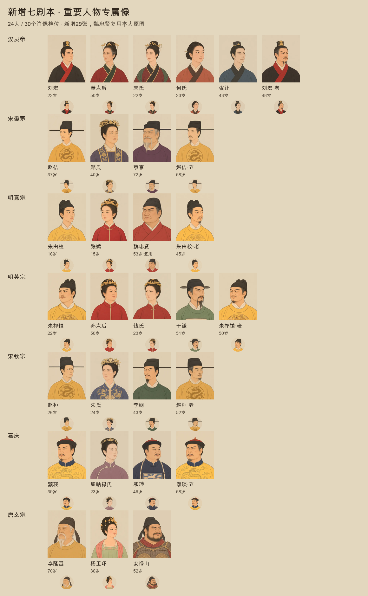
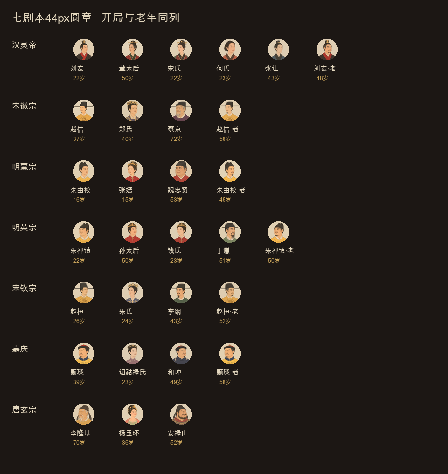

# 新增七剧本重要人物专属像 · 验收

日期：2026-11-10。基线main `d61ddd3`，分支`codex/important-portraits`，草稿[PR #11](https://github.com/Lynch715/yuji-emperor/pull/11)。**未合并、未发布。**

本批24人、30个肖像档位：新绘29张，魏忠贤复用崇祯局本人已验收专属。六帝另画本人老年续玩像，唐玄宗70岁开局仅一张老年像，同时映射base／old。详细名单、估龄及续玩假设见[实施说明](PR-IMPORTANT-PORTRAITS.md)。未覆盖人物继续取同朝代池，不借同姓人物的脸。

## 画风与辨识

每个专属像单张调用内置imagegen，传一期完整四图板与所属朝代完整四图板；老年另传本人青年像。原PNG及未选稿留本机忽略目录`art-source/important/`。仅裁切、等比缩放、导出400×500／q75 WebP，未用程序修脸或补画。长相卡和完整实际提示词、构图修订均记入[ART-PROMPTS](ART-PROMPTS.md)。

逐剧本目检44px：汉以交领冠制区分、董太后补强灰鬓眼袋和法令纹，与22岁的宋皇后分开；何贵人用单簪。明熹宗与张嫣保留16／15岁的少年少女特征；明英宗圆阔面、于谦清瘦长髯、孙太后宽圆成熟面。宋朝臣长直幞脚、帝王赭黄团龙；蔡京72岁灰白分叉长髯，李纲43岁清瘦短叉须。清以吉服冠／女式钿子／补褂顶戴区分帝后与和珅；唐玄宗白须、杨氏高髻凤钗、安禄山肥壮络腮甲胄。六对老年像保持本人面部身份，增加年龄特征；这部分不算同剧本不同人物撞脸。审美与历史容貌仍供玩家复核，不把设计脸型冒充史实。

单剧本原尺寸条：[汉灵帝](art-important-review/han-lingdi-44px.png)、[宋徽宗](art-important-review/song-huizong-44px.png)、[明熹宗](art-important-review/ming-xizong-44px.png)、[明英宗](art-important-review/ming-yingzong-44px.png)、[唐玄宗](art-important-review/tang-xuanzong-44px.png)、[宋钦宗](art-important-review/song-qinzong-44px.png)、[嘉庆](art-important-review/qing-jiaqing-44px.png)。

[六帝青年／老年对照](art-important-review/emperor-age-pairs.png)；[董太后初稿／最终](art-important-review/dowager-age-comparison.png)。

## 文件与游戏规则

- 新增29张，均400×500、WebP q75；合计298,960字节，最大17,194字节。最终眼线36.807–39.991%，冠顶10.000–13.996%，[逐张读数](art-important-review/asset-checks.json)。读数用于构图，最终面容与服饰另行目检。
- `assets/art/`共419个WebP／5,358,852字节（约5.11MiB）；即原390＋本批29。原377张原画加本批29＝406张原画，另13个场景派生档。原390张的SHA-256均与main相同，[完整散列](art-important-review/integrity.json)。
- 仅追加`ART_UNIQUE`，取图逻辑、池、场景、CSS、核心、存档v26均不改。旧七局154个专属档保持，新七局24人均可按本剧本姓名取专属，其他人物仍走原池。固定种子下14个剧本完整开局状态与发布基线逐字节一致，[状态散列](art-important-review/core-unchanged.json)。
- `npm test`647／647，包含旧档迁移、待续、幂等与取图退回；最终董太后替图后相关美术测试15／15。构建与diff检查通过，[测试记录](art-important-review/test-results.json)。
- 无模型模拟明英宗200年／7200旬，6朝、5次继位、未崩溃，[种子与结果](art-important-review/simulation-200y.json)。未接真实模型API。

## 浏览器与退回

功能交互和截图均用新版Codex In-app Browser，地址`http://127.0.0.1:4240/`，没有操作正式站或私人存档。七位皇帝逐一在真实开局预览中加载本人400×500专属；本地空卷新建明英宗试读，实测于谦召见纸面、钱皇后后宫人物卡、孙太后宗室头像。没有推进旬或调用模型。真实游戏console warn／error为空。[完整DOM读数](art-important-review/browser-checks.json)。

只读图册复用正式`portraitHTML`／`initArt`及原CSS，不读写游戏进度。30个档位各有圆章、人物卡、纸面，90／90加载；1280／768／390宽无溢出，额外360宽通过。纸面桌面200×250、手机120×150，行动头图手机112px，未露出画框边缘。董太后最终替图后重新加载90／90，[最终读数](art-important-review/dowager-final-check.json)。

| 画面 | 截图 |
| --- | --- |
| 1280召见纸面 | [于谦](art-important-review/game-audience-1280.jpg) |
| 390召见纸面 | [于谦](art-important-review/game-audience-390.jpg) |
| 390后宫／宗室 | [钱氏](art-important-review/game-harem-390.jpg)、[孙太后](art-important-review/game-dowager-390.jpg) |
| 图册三档 | [1280](art-important-review/gallery-1280.jpg)、[768](art-important-review/gallery-768.jpg)、[390](art-important-review/gallery-390.jpg) |
| 董太后最终稿 | [390三尺寸](art-important-review/dowager-final-390.jpg) |
| 关闭插图 | [90个实例退回44px首字圆章](art-important-review/fallback-off-1280.jpg) |
| 文件缺失 | [404退回刘字圆章](art-important-review/fallback-missing-1280.jpg) |
| 图片服务不可达 | [停止本地服务后退回44px圆章](art-important-review/fallback-unreachable-360.jpg) |

关闭插图后90个图均隐藏、90个实例退回44px圆章；恢复开关后正常。缺图测试使用明确的不存在URL；不可达测试保留已加载文档后停止本地图片服务，再触发一次未命中图片，首字圆章生效，页面仍可操作。**这里验证的是图片请求失败的退回，不声称离线刷新整站可用**。测试后服务和插图均恢复。图册中有意触发的失败与正常游戏console结果分开记录。

纸面标题／正文12.34:1、弱提示4.83:1，未新增文字叠图或CSS。官方Lighthouse13.6.0独立headless可访问性审计100分、无失败项；功能浏览器仍为应用内浏览器。[审计记录](art-important-review/lighthouse.json)。本批只供分支审阅，未做Pages发布与线上抽查。
