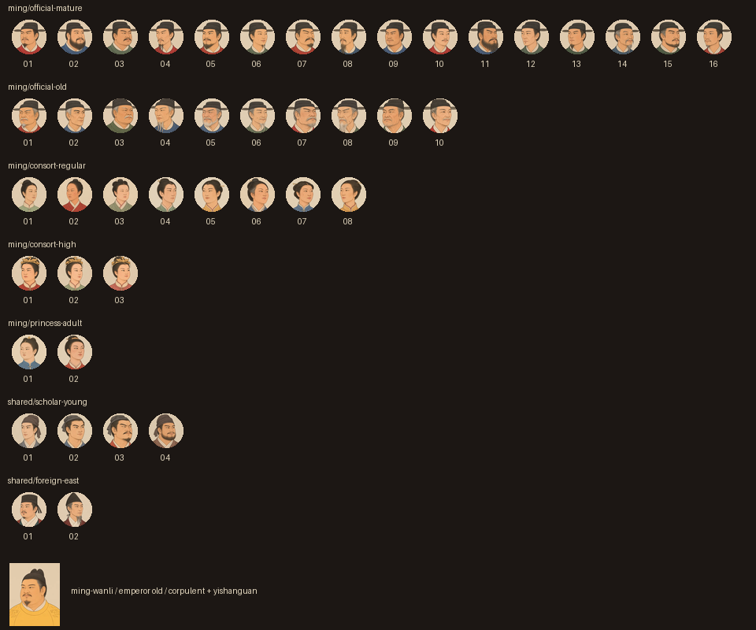
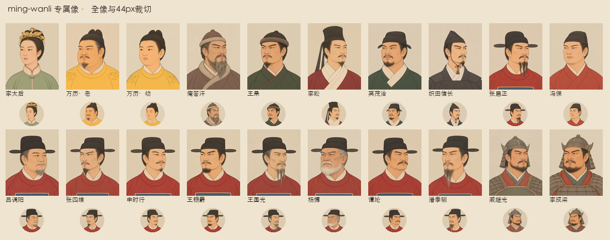
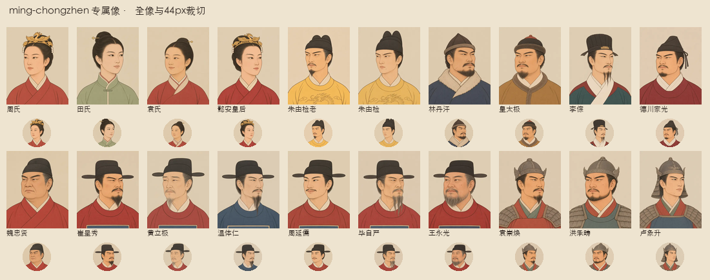
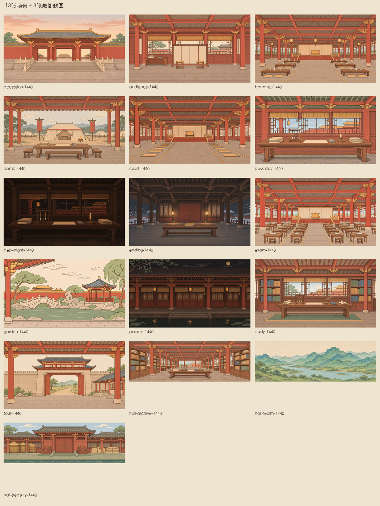
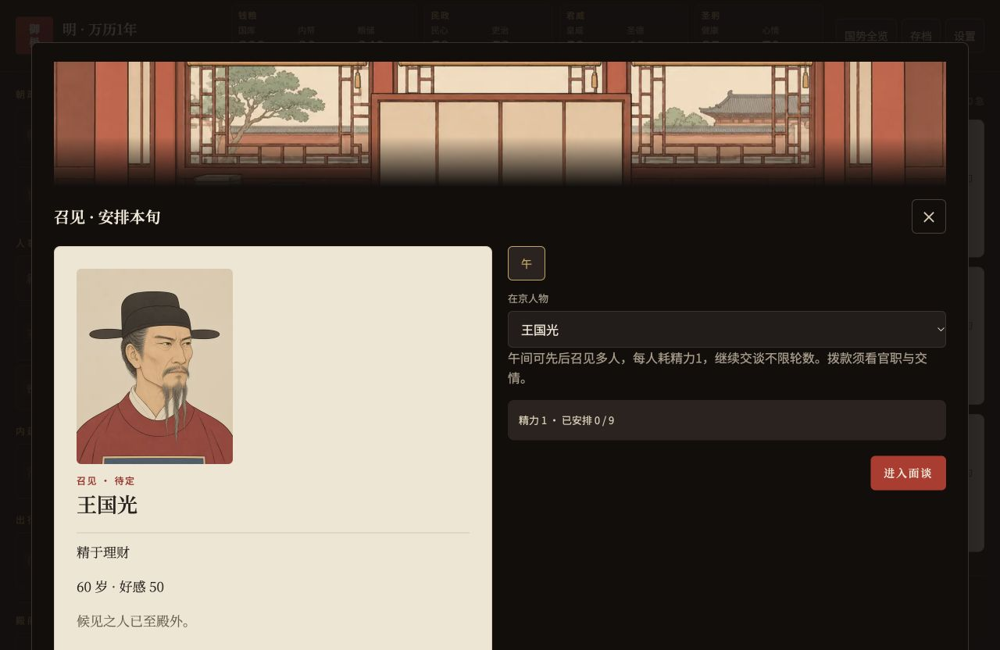
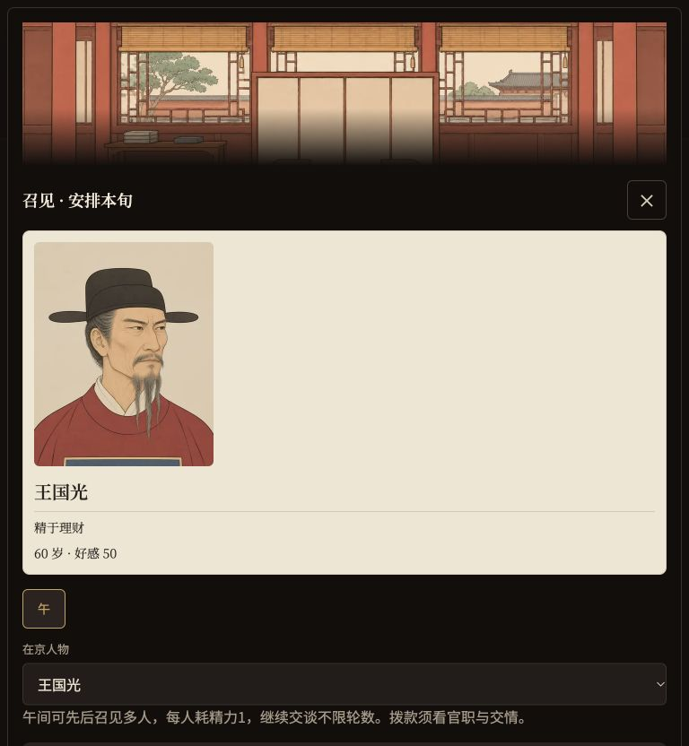
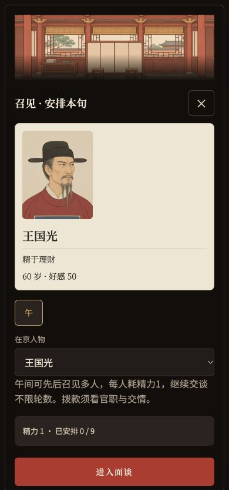

# 美术一期 · 132张完成（草稿PR）

基线：main / `093eaad`。分支：`feat/art-phase1`。一期 **132／132张内容** 已生成并接入；未提交的shared新图一并纳入。保留草稿，等待玩家测试，不合并main、不发布Pages。

## 完成范围

| 范围 | 已完成／目标 |
| --- | ---: |
| 明／大晟人物池 | 56／56 |
| 共用池（外邦、幼童、士子） | 20／20 |
| 万历／崇祯专属像（含两位皇帝老年像） | 40／40 |
| 场景 | 13／13 |
| 殿阁题图 | 3／3 |
| 合计 | **132／132** |

116张人物、13张场景各两档、3张殿阁题图，共 **145个WebP，2,994,276字节**。其他二、三期的245个内容位仍为空；七剧本姓名映射完整，本期两剧本全部开局人物及两张老年皇帝像已实图核验。

## 本轮审图修订

- 重出全部26张明制文官池图：统一参照万历张居正专属像的平顶乌纱帽，前低后高、帽后水平扁椭圆展角；官袍仅红、青、绿，禁黄／赭黄／金黄。指定的壮05／09／13、老04／08已改色。
- 常位后妃02／03／06、公主成年01改为明确女性、柔和眉眼；正位01–03补可辨凤形、展翼与珠串冠形。壮年02改富态络腮胡、14明显年长；青年士子01清瘦无须、04宽方富壮络腮胡。按玩家要求改变上述差异，其余长相卡维度保留。
- 万历老年像改富态、双下颌与翼善冠；海东01／02以高冠／乌帽子、宽领冠服区别于明制士子。共重出38张既有画像，先展示新44px对照，再补余下37专属像、11场景和3殿阁题图。
- 所有实际提示词、长相卡与修订记录见 [ART-PROMPTS](ART-PROMPTS.md)。工具为内置imagegen，未用外部API；源PNG只在本机忽略目录art-source。最终导出只裁切、等比缩放、转WebP。

## 实现与规范取舍

1. 引擎v24永久脸号、迁移补号及回合末补号；界面纯函数按更新后的§3.4避让，含已故者最后归池和占脸，池满新人优先复用全已故占用脸。可选artFaces保留已有脸和最后归池；空位也参加分配，补图不重编号。
2. 章节只存文字，完成后原日程已清空，因此界面附可选artScenes场景键；不存整份日程，不改结算、随机数或模型提示词。旧章节用已有地点或御案日夜默认图。
3. 旧测试的830KB单文件限额早于美术接入，调整为860KB；当前HTML **848,124字节**，图标原60KB预算不变，图片仍独立按需加载。皇嗣读取实际sex／born字段；太后姓名字符串按当前剧本映射。
4. imagegen返回近似画布，按实际分界裁切至规范导出尺寸。2×2尾组只画清单所需人物，空格不增加资产。四张修订定调样张作为后续新增图的参考。
5. 玩家要求凤冠、海东高冠一眼可辨，冠尖留白允许约7–9%，小于§3.1的10–14%；眼线保持36–40%，冠尖不裁断，44px另复核。该取舍已在导出前写入PR。四次仅调冠高／史册位置的局部编辑使用目标原图加一张风格图，减少换脸或场景串入；其余新增图带四张定调参考。
6. §9本地Lighthouse首轮94分暴露既有禁缩放与可见标签不一致。已先在PR说明，再移除viewport、Safari手势及根节点对缩放的限制，保留视口避让和普通滚动；奏报无障碍名称包含装饰字、数量徽标与可见标签。删除与新要求冲突的旧禁双指测试，F1继续验证滚动、缩放和视口契约。均为界面可访问性修正，不改引擎。

## 验证

- **593／593测试通过**（增加两朝专属取图与40岁切换回归，删除1条旧禁缩放要求）；200年／7200旬mock模拟通过，5次继位、0亡国、终局国库2040；原七条政务路径预演哈希不变。
- 清单引用与145个实际文件一一对应。人物400×500／q75，最大18,098字节；场景1440×810／720×405、q72，最大123,000／43,304字节；殿阁1440×480／q72，最大81,244字节。总量约2.99MB，低于12MB。
- 应用内浏览器localhost:4197：1280／768／390召见纸面截图，360无横向滚动；390行动头图340×112，实际取720档，画面完整覆盖。新专属人物卡64×80、手机纸面120×150正常；三殿阁题图手机120px高正常。
- 首屏加载4张新增图片；插图开关关闭后刷新仍无图片请求地址。临时移走全部assets/art后退回首字圆章及纯色头部，恢复后重新加载，未发现脚本错误；未使用玩家原档或真实模型API。
- Lighthouse13.6.0：开局页100；真实renderApp输出的大晟／万历／崇祯游戏首屏快照各100。此为隔离自动审计；交互验收与截图使用应用内浏览器。未做实体手机手势或线上部署验收。
- 按workflow路径复制145个WebP逐个SHA-256相同，源PNG、审阅图不进站点产物。只更新测试分支与草稿PR。

## 最新对照与截图

逐池44px、裁切及预算详见 [验收记录](ART-PHASE1-QA.md)。早期定调截图继续保留作历史记录，最新版本以nov6目录为准。
