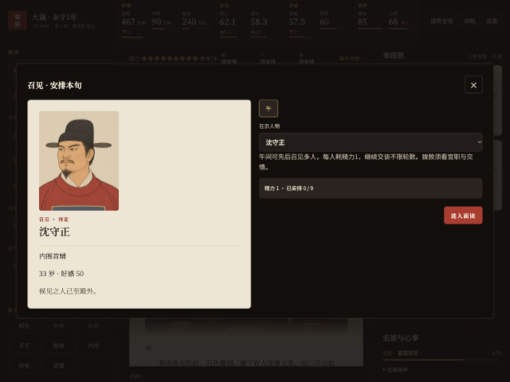
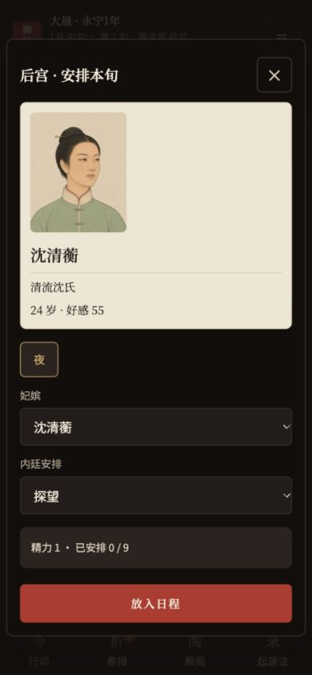
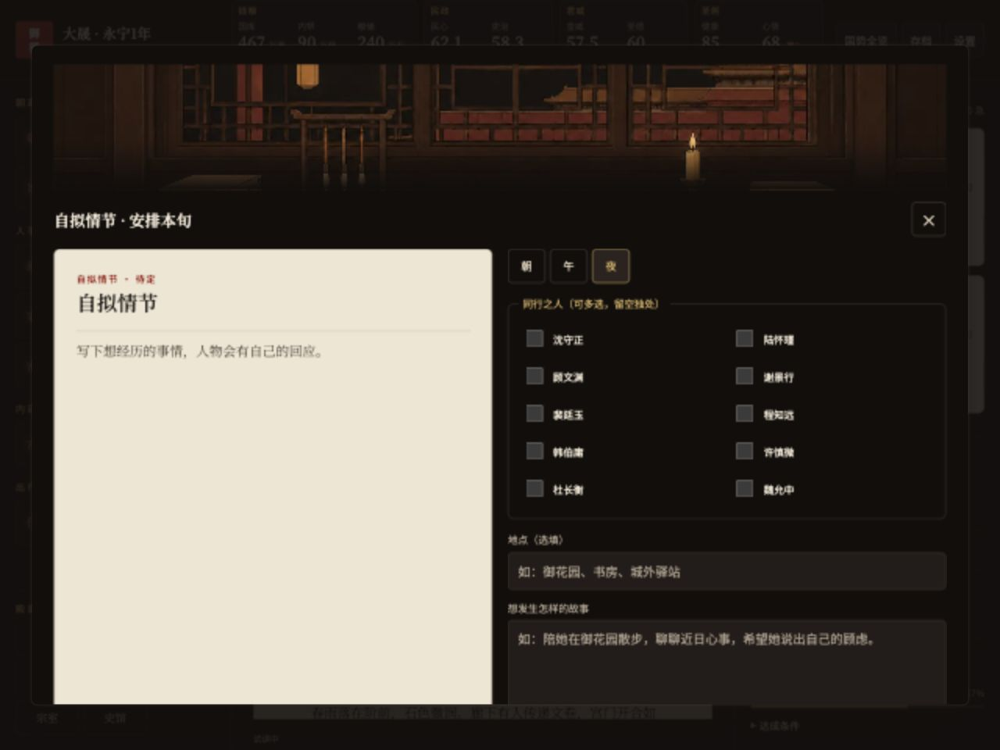
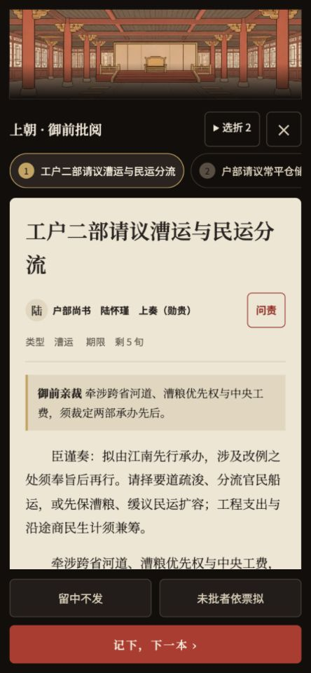
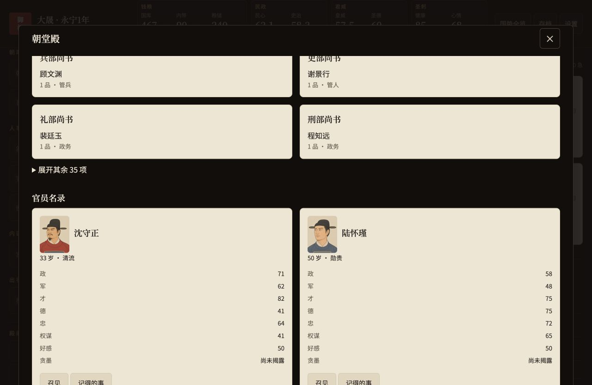
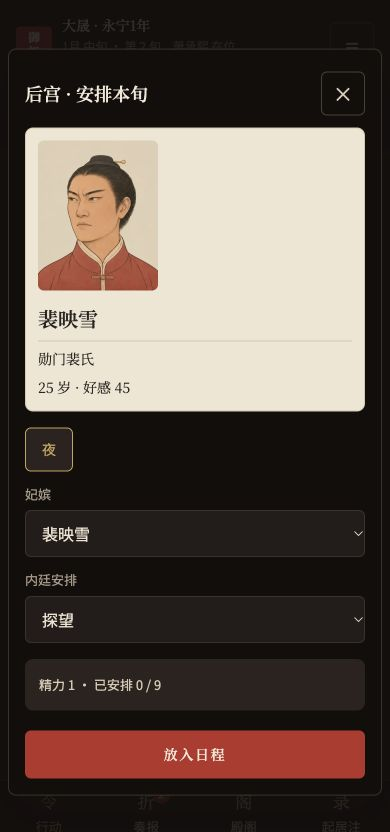
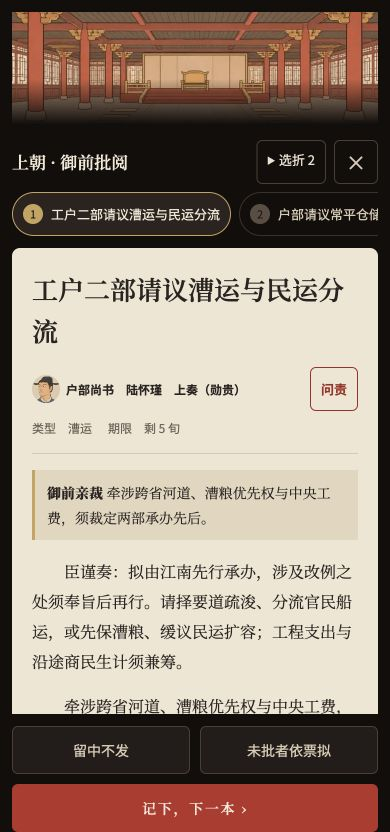
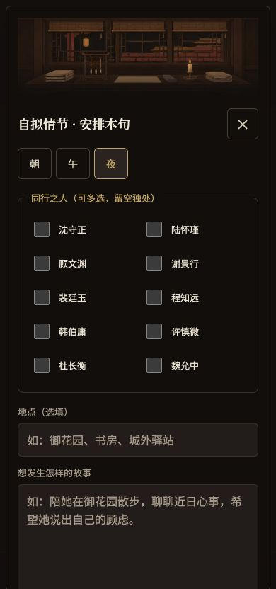

# 美术一期 · 代码接入与第 1–20 批（草稿 PR）

基线：main / `093eaad`。分支：`feat/art-phase1`。步骤 1、2 已完成；玩家已确认白描淡彩，并授权修订四张样张后继续两组各 10 批。本轮完成 20 批新增人物像，一期累计 **62／132 张内容**。保持草稿审阅，不合并、不发布 Pages。

## 已完成与余量

| 范围 | 已接入 | 一期目标 |
| --- | ---: | ---: |
| 明／大晟人物池 | 56 | 56 |
| 共用池 | 4（青年士子） | 20 |
| 万历／崇祯专属像 | 0 | 40 |
| 场景与殿阁题图 | 2（desk-night、court） | 16 |
| 合计 | **62** | **132** |

20 批新增 58 张人物；加上两张定调人物，共 60 张人物像。两场景各含大小两档，因此仓库共有 64 个 WebP，合计 876,700 字节。尚余 70 张内容；本轮皇帝青、老像属于通用明制池，万历和崇祯的专属老年像仍待制作。

## 实现与规范说明

1. 章节需要记住原行动类型，但现有章节只保存结算文字，回合完成后日程已经清空。界面提交后以可选 `artScenes` 保存三个场景键，不保存整份日程，不改引擎结算、随机数或提示词；旧章节没有该显示元数据时使用已有地点信息或御案日夜默认图。
2. 历史工程测试的 830KB 单文件上限早于本次接入。新增清单和取图代码使脚本增长，HTML 上限调整至 860KB，原图标 60KB 预算不变；当前 HTML 为 844,922 字节，图片仍独立按需加载。
3. 实际皇嗣字段是 `sex` 与 `born`。界面兼容读取 `gender || sex`，年龄从 `(turn-born)/36` 计算。太后仍为姓名字符串，按剧本姓名查专属像；明制通用太后池使用固定号 0。
4. 内置 imagegen 返回近似画布尺寸，提示词仍指定规范尺寸。保留工具原始 PNG，按实际分格裁切、等比缩放后导出规范尺寸 WebP；服饰、年龄和构图问题均回到 imagegen 修订。
5. 每批为同池同档位 2×2；尾组仅画清单所需人物，其余格留空，不增加清单外人物。四张修订样张作为后续生成的画风参考。所有长相卡、实际生成和修订提示词见 [ART-PROMPTS](ART-PROMPTS.md)。

## 按更新后的 §3.4 执行

- 引擎只发号；界面纯函数按脸号依次取未占脸，已故者保留最后归池并继续占用。池满时，新人先复用占用者全已故的脸，无可复用才取模。
- 可选 `artFaces` 显示表保留已有选择和最后归池，避免死亡清空官职后误归池，也避免已有溢出者被重新当作新人分脸。纯函数不读 DOM、本机存储或随机数；空图位也参与分配，补图不改变图号。
- 25 官员无重复测试使用各池未超容量的固定种子；另测超容量按 §3.4 复用。随机开局若某年龄池超出容量，会依规范轮回。

## 验证

- `npm test`：**593／593** 通过；200 年／7200 旬 mock 模拟通过，五次继位、零亡国、终局国库 2040。原七条政务预演哈希不变。
- 60 张人物均为 400×500 / q75，最大 18,098 字节；场景为 1440×810 和 720×405 / q72，均低于单张预算。清单引用与实际 64 个 WebP 一一对应。
- 所有已完成池均制作并目视复核 44px 圆形对照条；同池长相卡至少四维不同，脸型或胡须／发际线不同。常位后妃 8 张左右各 4 张。
- 应用内浏览器复验 1280／390 人物卡和纸面；390 下 court 头图 366×112、desk-night 头图 340×112，实际加载 720×405，图像完整覆盖容器；360 无横向滚动，浏览器脚本错误为空。
- 前阶段的无图回退、资源移走恢复、本机开关刷新保持及老存档保护验收继续保留，详见 [QA](ART-PHASE1-QA.md)。使用独立 localhost:4196 试读档，未使用玩家原档或真实模型 API。
- 原图只在本机忽略目录 `art-source/`。仓库保留 WebP、提示词和审阅截图；Pages 产物只包含页面与 WebP。尚未执行线上部署、实体手机或 Lighthouse 验收。

## 四张修订样张截图

## 本轮接入与手机裁切

全部已完成池的 44px 对照条见 [验收记录](ART-PHASE1-QA.md#44px-同池对照)。
