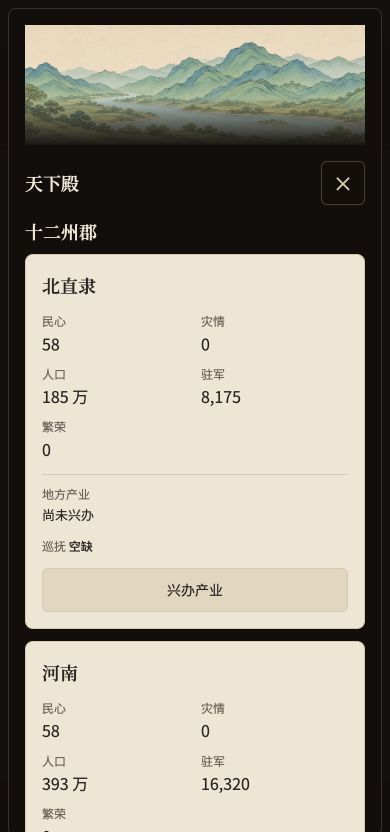
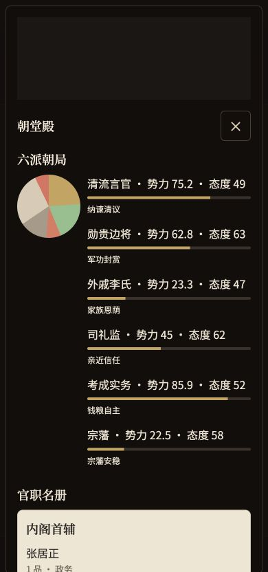
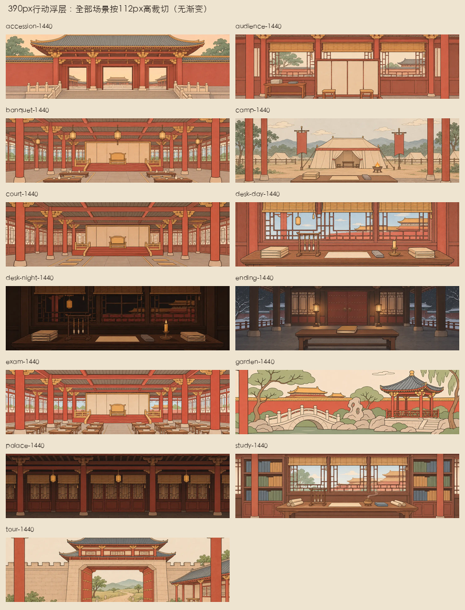

# 美术一期 · 最终验收

日期：2026-11-06。基线main／093eaad，分支feat/art-phase1。一期132／132张内容完成，145个WebP。保持草稿PR待玩家测试，未合并、未发布Pages。

## 资产与构图

明池56、共用池20、万历与崇祯专属40、场景13、殿阁3。其他245张不在本期，预留空位不请求。两朝开局每个人物均取专属像，皇帝39岁／40岁切换已测；七个剧本的全部姓名与阶段变体位均保留。

按玩家审图重出38张：26文官统一平顶前低后高乌纱帽、帽后水平扁椭圆展角和红青绿袍；4女性像柔化；3正位凤冠；2青年士子分开；万历富态老像；2海东冠服。文官02、14的脸型／胡须／年龄差异按要求调整，其余长相卡保留。明制服饰约束已写入ART-PROMPTS。

长相卡先于生成，池图按2×2组生成、专属像逐张生成。实际提示词均留档。每池实际44px圆章按object-position50%32%对应裁切复核，新增两朝专属像亦有全像与44px对照。人物目标眼线36–40%；凤冠、高冠约7–9%冠尖留白的取舍及四次局部编辑参考图方式，已先记入PR。

场景不画可辨人物，夜廊无床榻，军营无战斗。全部满幅到边；天下题图为纯青绿山河长卷。御花园初稿1440档超150KB，回到imagegen简化枝叶与纸纹后通过，未降低q72。史册移入中间带，ending焦点50%70%，其余场景50%50%。

全部资产总计 **2,994,276字节**。实际尺寸逐个由Pillow读取校验，人物最大18,098、场景大／小最大123,000／43,304、殿阁最大81,244字节；分别低于30,000、150,000／60,000、100,000预算。清单路径集合与145个实文件完全相等。源PNG只留art-source；导出只裁切、等比缩放和格式转换。

| 人物池／专属组 | 张数 | 字节 |
| --- | ---: | ---: |
| `ming/consort-high` | 3 | 41,760 |
| `ming/consort-regular` | 8 | 75,728 |
| `ming/dowager-all` | 1 | 14,812 |
| `ming/emperor-old` | 2 | 33,086 |
| `ming/emperor-young` | 2 | 24,236 |
| `ming/eunuch-all` | 2 | 17,956 |
| `ming/general-all` | 4 | 69,814 |
| `ming/official-mature` | 16 | 175,446 |
| `ming/official-old` | 10 | 133,148 |
| `ming/prince-adult` | 2 | 20,074 |
| `ming/prince-teen` | 2 | 21,644 |
| `ming/princess-adult` | 2 | 20,530 |
| `ming/princess-teen` | 2 | 21,388 |
| `shared/boy-young` | 2 | 20,282 |
| `shared/foreign-east` | 2 | 20,668 |
| `shared/foreign-north` | 2 | 27,204 |
| `shared/foreign-south` | 2 | 20,258 |
| `shared/foreign-west` | 2 | 30,586 |
| `shared/girl-young` | 2 | 20,822 |
| `shared/scholar-mature` | 4 | 47,014 |
| `shared/scholar-young` | 4 | 47,698 |
| `unique/ming-chongzhen` | 20 | 193,344 |
| `unique/ming-wanli` | 20 | 190,740 |

## 代码、存档与自动验证

- assignFaces纯函数不读图片池、不掷骰。官员共用递增号；候选与后妃接续号，迁移与提交补号；无待补项保留状态引用。存档v24、老档原骰与待续预演保留，commitTurn幂等。
- UI纯函数按更新§3.4避让，已故者按最后年龄／官职继续占脸；新来者池满优先复用全已故占用脸，再取模。artFaces显示表避免亡故清职后换池及溢出者重分；artScenes只存显示键，不改数值。
- Node **593／593通过**。本轮新增两朝全部开局专属取图、跨剧本同名不串像、40岁老年切换、纯函数不改状态；清单测试核对145实文件与体积。旧禁双指测试与新可访问性要求冲突，已删除1条并同步F1契约。
- 200年／7200旬，种子“御极·两百年”，5次继位、0亡国、终局国库2040；mock叙事。原七条政务路径哈希逐条不变。
- 构建98模块、脚本787,149字节；HTML848,124字节＜860KB。模拟、测试、构建及diff空白检查通过。按workflow原路径复制145张WebP，逐个SHA-256一致。

## 应用内浏览器实走

使用独立localhost:4197试读档，未读写玩家原档，未调用真实模型。全程应用内浏览器，无Chrome功能验收降级。

| 项目 | 结果 |
| --- | --- |
| 1280／768／390召见纸面 | 新王国光专属像与audience场景正常 |
| 手机行动头图 | 340×112，720×405源，cover完整铺满，无画面边缘 |
| 人物卡／手机纸面 | 64×80／120×150 |
| 三殿阁题图 | 天下／内库／史馆加载成功，手机120px高 |
| 360布局 | 文档scrollWidth=360，无横向滚动 |
| 首屏资源 | 新图4张，低于6张 |
| 插图开关 | 关闭并刷新后img/src、source/srcset为0；重新开启恢复 |
| 缺图回退 | 临时移走assets/art，显示首字圆章、纯色章节／题头；恢复后图片重载 |
| 控制台 | 未发现脚本错误；缺图场景的失败资源属于预期回退测试 |
| 缩放 | viewport无缩放上限、根touch-action=manipulation，无Safari手势拦截；实体双指手势待玩家设备验收 |

原始JPEG在docs/art-phase1-review/nov6；qa/art-1280-final.png、qa/art-768-final.png、qa/art-390-final.png为同截图无损格式转换，符合本地归档命名。最终截图与浏览器摘要另留qa/art。

## Lighthouse与对比度

Lighthouse13.6.0隔离无头审计：开局页100，大晟／万历／崇祯游戏首屏快照各100。游戏快照由当前renderApp与真实初始状态输出，含实际插图、奏报头像和移动导航；不替代应用内浏览器的交互实走。完整JSON留本机qa/art，摘要随审阅图归档。

首轮94分发现既有禁缩放与导航标签问题，已先在PR写原因；实际解除viewport、根CSS和Safari手势拦截，不仅修改审计元数据。移动奏报可见印字、徽标计数及名称均纳入aria-label。文字位于图后／渐变暗端，color-contrast审计通过，未把标题直接压到画面主体。

## 全部人物池44px对照

**ming/consort-high**

**ming/consort-regular**

**ming/dowager-all**

**ming/emperor-old**

**ming/emperor-young**

**ming/eunuch-all**

**ming/general-all**

**ming/official-mature**

**ming/official-old**

**ming/prince-adult**

**ming/prince-teen**

**ming/princess-adult**

**ming/princess-teen**

**shared/boy-young**

**shared/foreign-east**

**shared/foreign-north**

**shared/foreign-south**

**shared/foreign-west**

**shared/girl-young**

**shared/scholar-mature**

**shared/scholar-young**

## 专属像与场景总览

## 验收边界

一期资产余量为0。其他朝代属二、三期；保留空位。线上Pages取图待玩家测试并授权合并发布后验证；本轮没有部署。实体手机、真实模型文风未测。原有海报、推广文件和历史审计／方案文档未纳入本次提交。
