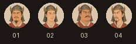

# 美术一期 · 代码、修订样张与第 1–20 批验收

日期：2026-11-05。基线：main / `093eaad`。分支：`feat/art-phase1`。画风已确认；步骤 1、2 与两组各 10 批完成，一期累计 62／132 张内容。未合并 main、未发布 Pages。

## 代码与存档

- `assignFaces` 位于 `src/core/faces.js`，纯函数，不掷骰、不读图片池。官员共用计数器，候选与后妃共用计数器，留牌保号；初始开局、迁移和回合末尾调用。无待补项时保留状态引用，不打断异步请求。
- 存档 v24，旧档按数组顺序补号，原待续预演逐字保留，提交时升级结果。原骰、数值、账目及幂等凭据不变；可选 `artFaces` 与章节 `artScenes` 只用于显示。
- 取图避让位于 `src/ui/art.js`。按更新后的 §3.4 保留已故者最后归池和占用；满池新人先取全为已故者占用的脸，无可复用才取模。已有溢出者不因死亡换脸；升档或调职可依规范重排。旧档若已失去亡故前官职且没有显示表，首次只能按存档现有资料归池，此后保留。
- 固定种子「脸号回归」开局 25 官员各池未满，25 个 `(池,图号)` 全不重复；另测池满复用及已有溢出者死亡稳定。有限池遇到超容量年龄分布时，按规范轮回。
- 完整清单仍为池图 207、专属像 154、场景与题图 16，共 377 个内容位。本轮接入人物池 60、场景 2；其余为空，不请求未生成图片。

## 自动验证

- `npm test`：**593／593**，零失败、跳过或取消。
- `node scripts/simulate.mjs 200`：种子「御极·两百年」，7200 旬、五次继位、零亡国、终局国库 2040；仅 mock 叙事。
- `node scripts/batch5-format-proof.mjs --stdout`：原七条政务路径预演哈希不变，仅排除新增脸号与计数器，旧字段继续逐项校验。
- `npm run build`：98 模块，脚本 783,915 字节，HTML 844,922 字节，小于 860KB；图标原预算不变。
- 64 个实际文件与清单引用一一对应。全部人物以 Pillow 核对为 400×500，场景两档分别为 1440×810、720×405；人物最大 18,098 字节。
- 本地按 workflow 同样规则核对 WebP 原路径复制，源 PNG 和审阅图不进入站点产物；未触发 Pages 工作流。

## 进度与资产预算

第 1–10 批新增 34 张，第 11–20 批新增 24 张。加两张修订定调人物，共 60 张人物像；再加两张场景内容，共 **62／132**。64 个 WebP 合计 **876,700 字节**。

| 人物池 | 已完成 | 文件字节合计 |
| --- | ---: | ---: |
| `ming/consort-high` | 3 | 31,810 |
| `ming/consort-regular` | 8 | 77,582 |
| `ming/dowager-all` | 1 | 14,812 |
| `ming/emperor-old` | 2 | 33,086 |
| `ming/emperor-young` | 2 | 24,236 |
| `ming/eunuch-all` | 2 | 17,956 |
| `ming/general-all` | 4 | 69,814 |
| `ming/official-mature` | 16 | 183,532 |
| `ming/official-old` | 10 | 127,620 |
| `ming/prince-adult` | 2 | 20,074 |
| `ming/prince-teen` | 2 | 21,644 |
| `ming/princess-adult` | 2 | 22,594 |
| `ming/princess-teen` | 2 | 21,388 |
| `shared/scholar-young` | 4 | 48,856 |

人物统一 q75。场景统一 q72：

| 场景文件 | 尺寸 | 字节 | 预算 |
| --- | --- | ---: | ---: |
| `court-1440.webp` | 1440×810 | 84,522 | 150,000 |
| `court-720.webp` | 720×405 | 29,912 | 60,000 |
| `desk-night-1440.webp` | 1440×810 | 35,992 | 150,000 |
| `desk-night-720.webp` | 720×405 | 11,270 | 60,000 |

## 构图与服饰复核

- 明制乌纱帽改为前低后高、帽后扁椭圆展角，去除礼帽式连续帽檐。武将重新修订为凤翅金属盔；皇帝使用后翼向上折起的翼善冠。
- 常位后妃采用鬏髻或小发冠、竖领或交领袄；正位简化凤冠。所有明制后续生成沿用该约束，写于 ART-PROMPTS。
- 批量初稿的偏低眼线回到 imagegen 修订，再按每格实际分界与构图裁切。青年人物减少过重老态，少年皇嗣按真实年龄重修。
- desk-night 的西式窗帘改竹帘，顶部补梁架、下部补案腿与地面，保留暗度；court 顶部补梁枋。场景均画到四边。
- 先写长相卡再生成；同池任意两张卡至少四维不同，脸型或胡须／发际线不同。按 44px 目视对照复核；常位后妃朝向纠正为左右各四张。
- 原 PNG、生成记录和裁切坐标留在本机 `art-source/`、`qa/art/`；最终导出只切格、裁切、等比缩放、WebP 转换。

## 应用内浏览器

使用独立 `http://127.0.0.1:4196` 试读档，未读取、修改或上传玩家原存档，没有真实模型调用。标签失效后按新版故障流程在同一应用内浏览器新建标签恢复，未降级 Chrome。

| 本轮核对 | 结果 |
| --- | --- |
| 1280 朝堂人物卡 | 新画像加载成功，64×80 |
| 390 后宫人物卡 | 正位、常位均加载成功，64×80 |
| 390 新常位后妃行动纸面 | 新像 consort-regular-02，120×150 |
| 390 court 行动头图 | 容器与 img 同为 366×112，720×405 源图，完整覆盖 |
| 390 desk-night 行动头图 | 容器与 img 同为 340×112，720×405 源图，完整覆盖 |
| 360 自拟情节浮层 | 文档 scrollWidth=360，浮层宽344，无横向滚动 |
| 浏览器日志 | 本轮脚本错误为空 |

四张样张重出后的 1280／390 截图和本轮接入截图均在 `docs/art-phase1-review/`，由 [PR 说明](ART-PHASE1-PR.md) 内嵌展示。下列前阶段验证记录继续保留，相关代码本轮未改：

- 1280／768／390 正文章节头，手机 96px、桌面120px；手机实际加载 720 档，章节和题图标题位于图后。
- 无图新局可用；临时移走整个 assets/art 目录后退回 44px 圆章及纯色章节头，恢复文件重开后画像再次加载，未记录脚本错误。
- 本机「显示插图」关闭时移除图片地址与 source/srcset，刷新保持关闭；重新开启后正常加载。
- 图片为空 alt、aria-hidden，姓名保留文字；未产出图不请求，人物依打开面板按需延迟加载。

## 44px 同池对照

以下为实际 44px 圆形裁图，每池一行，编号对应文件后缀：

**ming/official-mature**

**ming/official-old**

**ming/general-all**

**ming/eunuch-all**

**ming/consort-high**

**ming/consort-regular**

**ming/dowager-all**

**ming/emperor-young**

**ming/emperor-old**

**ming/prince-teen**

**ming/prince-adult**

**ming/princess-teen**

**ming/princess-adult**

**shared/scholar-young**

## 尚未完成

一期尚余 **70 张**：共用池 16、万历／崇祯专属像 40（含两位皇帝老年像）、场景与殿阁题图 14。其他朝代和其余专属像不属于本次 20 批；仍预留空位。

尚未运行本轮 Lighthouse、实体手机或线上部署验收；全一期 132 张和历史人物实图核对需在其余资产完成后进行。本轮只更新测试分支和草稿 PR，等待玩家测试。
