# 美术二期 · 清制 · 完整验收

完成日期：2026-11-07。分支`feat/art-phase2`，基于main／`34bdb82`；二期79／79张和前次修订已获玩家通过。本轮完成最终三张修订，按玩家授权进入PR #6合并与GitHub Pages发布。下方保留各轮验收历史。

## 合并前最终三张修订 · 2026-11-07 · 504e723基线

- 常位池05改为约26岁女子：全黑发、光洁年轻面貌、柔和眉眼，保留绛红立领旗装与44px可见的横向两把头；常位池也用于18—25岁秀女，已写入提示词共用约束。
- 康熙熊赐履07改为宽短方脸、粗颈宽肩、短直髭、严正神情，与明珠06的瘦长无须面貌分开；仍按剧本26岁及理学名儒性格绘制。
- 雍正允禟10改为低圆阔脸、丰腴体态、双颏、八字髭和短方颏须，与允祥02的清瘦疲惫、短须茬面貌分开；保留39岁和好结纳、经营商号的角色气质。

内置imagegen每次沿用一期四张板与清制四张板。两位官员初稿构图偏高，在生成端整体下移后再裁切、等比缩放、q75转WebP；没有手工修脸、改色或补画。PNG原稿及未选稿只存本机art-source。实际长相卡与每次提示词已先于生成记入[ART-PROMPTS](ART-PROMPTS.md)。

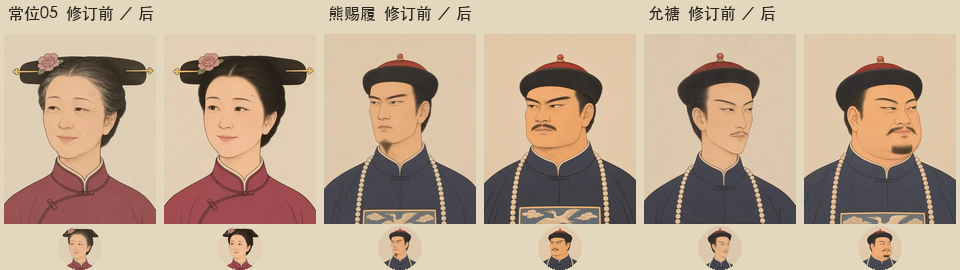

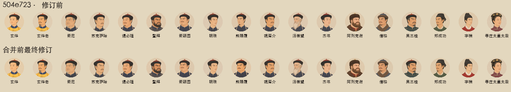

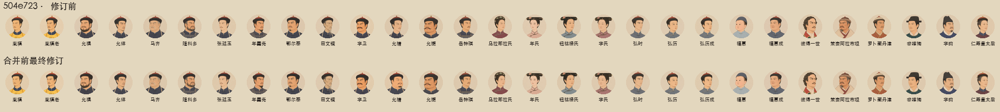

已逐组查看两剧本完整44px条及全头像，重点两对的脸型、须形、体态均可辨。常位池完整条也已更新。仅3个WebP变化，其余221个与504e723逐字节一致；源码、清单、生产HTML/CSS及存档逻辑不变，存档仍v25。二期79张 **729,230字节**；assets/art全目录 **224个WebP／3,678,390字节**；最大单头像15,242字节。79张全部400×500，帽／发顶10–14%、眼高36–40%，体积均在预算内。[资产与测试摘要](art-phase2-review/release-final-20261107/qa-summary.json)、[三张长相卡](art-phase2-review/release-final-20261107/revised-face-cards.json)。

本轮 **608／608测试、200年／7200旬mock模拟、构建通过**；模拟6朝、5次传承、无亡国，终局国库2040。HTML855,007字节。Lighthouse沿用bf98707六项可访问性100记录；本轮仅替换三张资产，未重复运行。

应用内浏览器经隔离localhost查看既有0旬试读卷：熊赐履与允禟真实朝堂取图均400×500加载，1280桌面及390手机显示正常，390无横向溢出。只查看人物、切换卷位，未执行回合。脚本warn/error为空。[本轮浏览器读数](art-phase2-review/release-final-20261107/local-browser-results.json)。

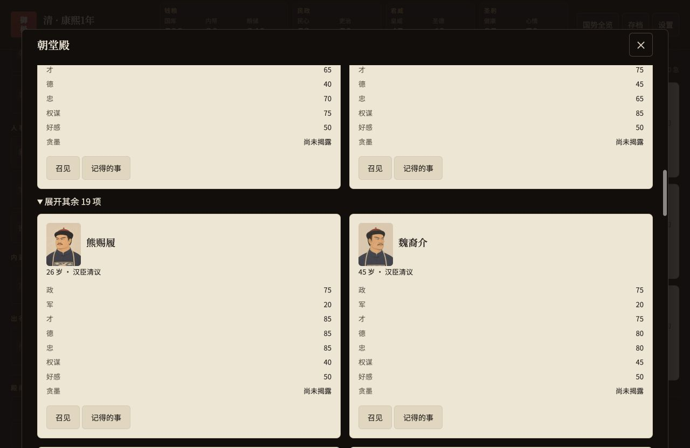

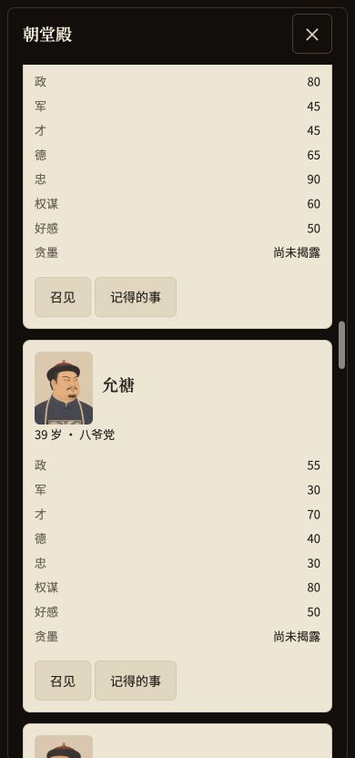

## bf98707验收后修订 · 2026-11-07

玩家已确认二期画风、服饰，本轮按反馈替换 **19张**（含可选玄烨老年像），二期总量仍为79张。所有修订继续使用内置imagegen，长相卡和实际提示词先于调用写入[ART-PROMPTS](ART-PROMPTS.md)；原始PNG与未选稿保留本机art-source/phase2/revisions-20261107及bulk目录。

| 范围 | 本轮修订 |
| --- | --- |
| 康熙孝庄`dowager-01` | 按开局48岁画约五十岁端庄妇人，细眼尾纹与成熟仪态，改戴女式扇形钿子、简花饰短珠串 |
| 康熙`official-05/06/07/10` | 索额图25岁富态圆脸、短髭小须与自得神情；明珠26岁瘦长菱形、无须与精明侧目；熊赐履26岁长方脸、稀下颏须与严正抿口；杰书明确16岁少年，柔和脸颊、细颈窄肩、无须 |
| 康熙`emperor-01-old` | 采用可选项，按54岁档加入灰鬓、灰须、额纹和眼尾纹，保留本人身份与吉服冠龙袍 |
| 雍正`official-01/02/09/10` | 允禩富态梨圆脸、整圈短须、亲和微笑；允祥清瘦长方脸、短须茬、疲惫眼袋与沉静；李卫宽五角脸、浓垂髭、粗健爽利；允禟狭长心形、细髭、狭眼与自得神情 |
| 雍正`official-11/12` | 允禵11改为魁梧宽方脸、厚颈、上翘浓髭与倨傲神情，与岳钟琪12的瘦长持重形象区分 |
| 雍正弘时／福惠成年 | 弘时18岁改瘦长菱形、窄颈、抿口与疏离神情；福惠假想20岁成年像为宽圆成人骨相、厚颈宽肩与温和微笑，保留圆脸鼻口和左颊酒窝线索 |
| 常位02—05 | 同池2×2重新生成：圆脸富态明快／长瘦脸寡言／软方脸端正／倒三角成熟耐心；衣色依次藕荷、湖绿、杏黄、绛红，保留横向扁平两把头 |
| 公主成年／少年 | 保留原面貌、年龄与发式，衣色分别改湖蓝、珊瑚粉；女性旗装不用明黄 |

已重拼康熙18张、雍正29张的完整44px条，并查看完整头像图，逐组复检同剧本脸型、须形、体态、神情；年龄变体按同一人保留身份线索。下面每张上下依次为bf98707／本轮修订。

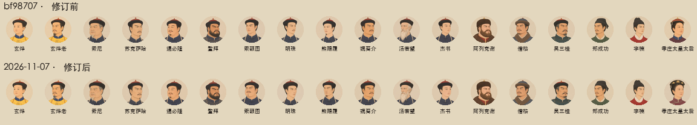

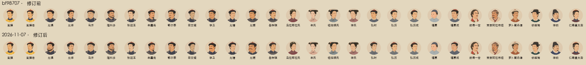

下列为指定人物逐张前／后对照：

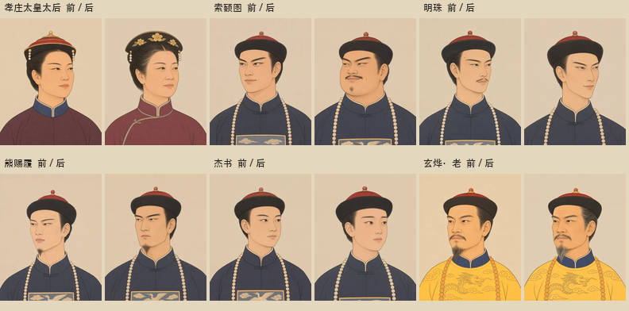

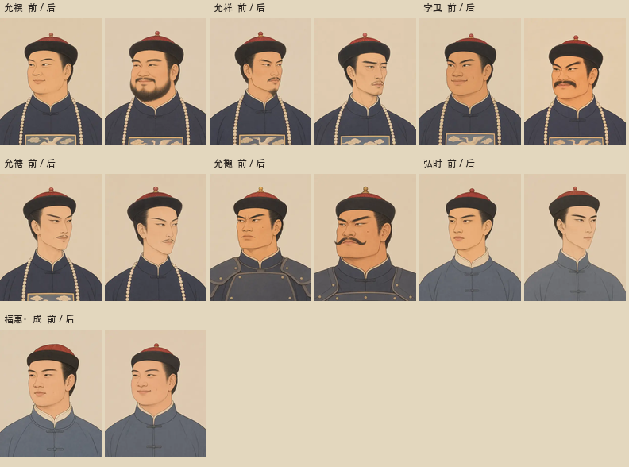

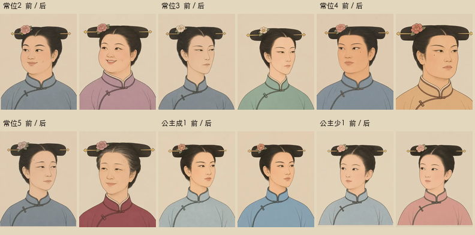

本轮构图复检：19张均400×500、q75、≤30KB；眼高36–40%、帽／发顶10–14%，不合格的三张在生成端下移后重新导出。仅裁切、等比缩放和转WebP，无手工修脸、改色或补画。全目录 **224个WebP、3,676,234字节**；二期79张 **727,074字节**，相比bf98707增加5,694字节，最大单张仍15,242字节。除19个指定文件外，其余205个WebP逐字节一致，源码、清单、生产CSS、HTML与存档规则也一致。详见[本轮资产、散列与验收摘要](art-phase2-review/revision-20261107/qa-summary.json)、[修订长相卡](art-phase2-review/revision-20261107/revised-face-cards.json)。

**本轮608／608测试、200年／7200旬mock模拟、构建通过**。模拟6朝、无亡国、终局国库2040；HTML855,007字节。生产`portraitSource`逐张核对19个文件键，均取到对应修订像；未修改取图或人物数值逻辑。

应用内浏览器经localhost验证：生产取图与CSS预览中的38幅纸面／44px图像全部加载；真实游戏复查康熙、雍正朝堂及孝庄宗室头像，沿用隔离端口的两卷试读存档，仅切换卷位和查看，仍为0旬。1280／768／390截图及360宽无横向溢出，脚本error／warn为空，已恢复默认视口。[浏览器读数](art-phase2-review/revision-20261107/browser-results.json)、[逐张取图核对](art-phase2-review/revision-20261107/portrait-source-checks.json)。

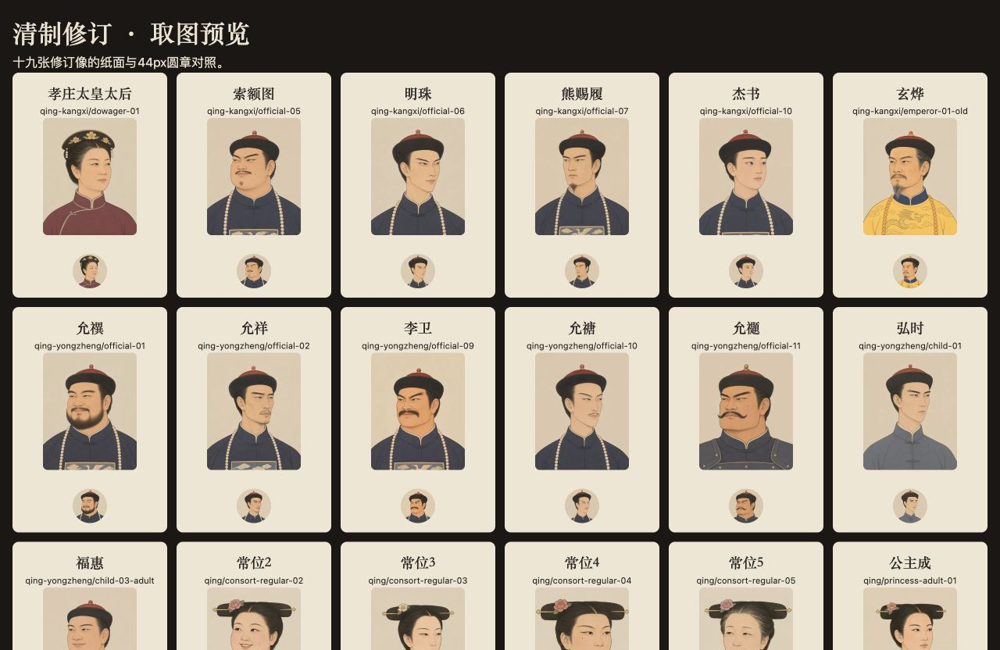

| 真实游戏 | 1280 | 768 | 390 |
| --- | --- | --- | --- |
| 雍正朝堂 | [截图](art-phase2-review/revision-20261107/yongzheng-court-1280.jpg) | [截图](art-phase2-review/revision-20261107/yongzheng-court-768.jpg) | [截图](art-phase2-review/revision-20261107/yongzheng-court-390.jpg) |
| 康熙朝堂 | [截图](art-phase2-review/revision-20261107/kangxi-court-1280.jpg) | — | [截图](art-phase2-review/revision-20261107/kangxi-court-390.jpg) |

另附[390旗装配色](art-phase2-review/revision-20261107/robe-colors-390.jpg)、[390孝庄实图](art-phase2-review/revision-20261107/kangxi-dowager-390.jpg)。以下完整二期验收保留原覆盖范围；断图、插图开关、对比度和六项Lighthouse100为bf98707阶段记录，本轮源码／HTML／CSS字节不变，未重复运行Lighthouse。仍更新草稿PR #6供玩家复核，不合并、不发布。

## 交付与体积

| 项目 | 张数 | 内容 |
| --- | ---: | --- |
| 清制池 | 32 | 文官壮10、文官老6、武将3、后妃正位2、常位5、皇帝青老各1、皇子少成各1、公主少成各1 |
| 康熙专属 | 18 | 17位开局人物＋玄烨老年像 |
| 雍正专属 | 29 | 26位开局人物＋胤禛老年像＋弘历、福惠成年像 |
| 二期合计 | **79** | 已有四张定调样张＋本轮其余75张；常位01按要求重出 |

二期WebP共 **727,074字节**，单张最大 **15,242字节**；全部400×500、q75，低于人物30KB预算。`assets/art/`累计 **224个WebP、3,676,234字节（约3.68MB）**，低于12MB总预算。一期132张内容因场景双分辨率共145个文件；加二期79张，累计211张内容／224个文件。后续朝代166张清单仍留空。

清单引用与实际文件一一对应。原一期145个文件逐字节比对一致，大晟、明朝及其他朝代配置、场景、题图、焦点保持一致；`src/core`无改动，存档仍v25。清制未建宦官池或太后池，内务府总管继续取文官池，两位太后均使用专属像。证据：[资产明细](art-phase2-review/final/asset-checks.json)、[隔离比对](art-phase2-review/final/isolation-checks.json)。

## 生成、长相与构图

全部使用内置imagegen。每池先写长相卡，逐对校验至少四维差异，脸型或胡须／发际线维度不同。池图按同池2×2生成，尾组空格留白，切开后仅裁切、等比缩放与转WebP；构图不合格的单人送回imagegen重出。专属像单张生成，依据`scenarios.js`中的年龄、性格、秘密与已列史料安排气质，八维五官设定属于创作，不冒充史实外貌。福惠成年像是游戏续玩所需的假想成年形象。

后续每次调用同时传入一期四张板、清制四张板，完整保留八张参照；工具最多五个参照文件的两板处理已在PR #6第1步事先说明。年龄变体另传本人基底像；福惠成年前两稿偏幼，最终v3保留完整八图风格板，依据本人圆脸、鼻口、暖白肤和左颊酒窝的文字线索重画成人骨相，去掉婴儿第三参照造成的比例干扰。实际提示词、每次修订理由均见[ART-PROMPTS](ART-PROMPTS.md)，可机读卡片见[face-cards.json](art-phase2-review/final/face-cards.json)。

`qing/consort-regular-01`已改为头顶左右对称横展的扁平两把头，配扁方和少量簪花。后续常位五张、成年公主及历史常位均沿用；正位钿子／朝冠与横向发髻可直接区分。常位04另在生成端柔化眉眼，保留宽脸、鼻口、体态和小痣。全部人物无文字、胸前垂辫或演员借脸。

最终帽／发顶为10.00%–13.99%，双眼36.00%–39.99%；批量像使用Vision CPU眼部定位与像素帽顶辅助并人工查看，样张沿用人工测量，误差约±5px。44px圆章按生产CSS焦点50%／32%裁切。各池与两剧本均已查看全图、44px条；以脸型、胡须、体态、神情拉开，年龄变体保留本人身份线索。最终PNG原图、所有未选稿在本机`/Users/ruis/Claude/Projects/皇帝模拟器/art-source/phase2/`；仓库美术资产只提交WebP。

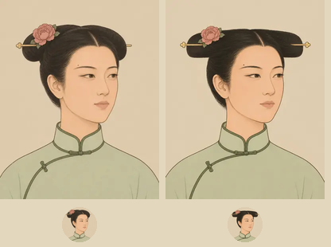

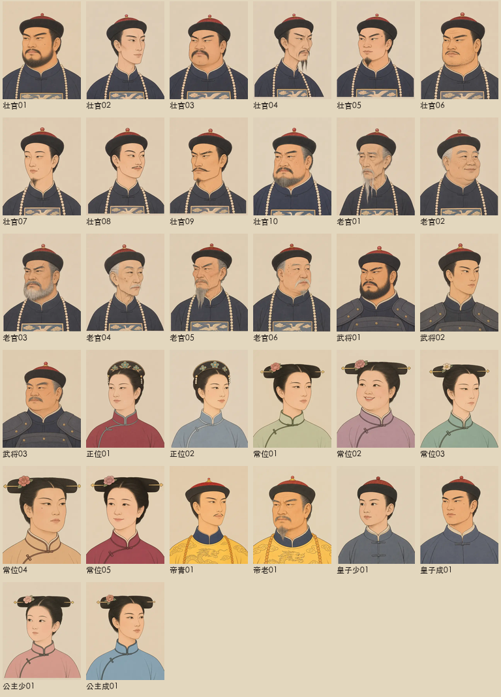

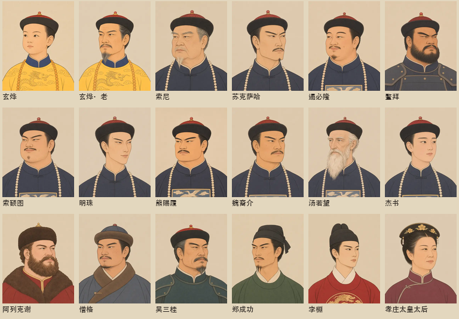

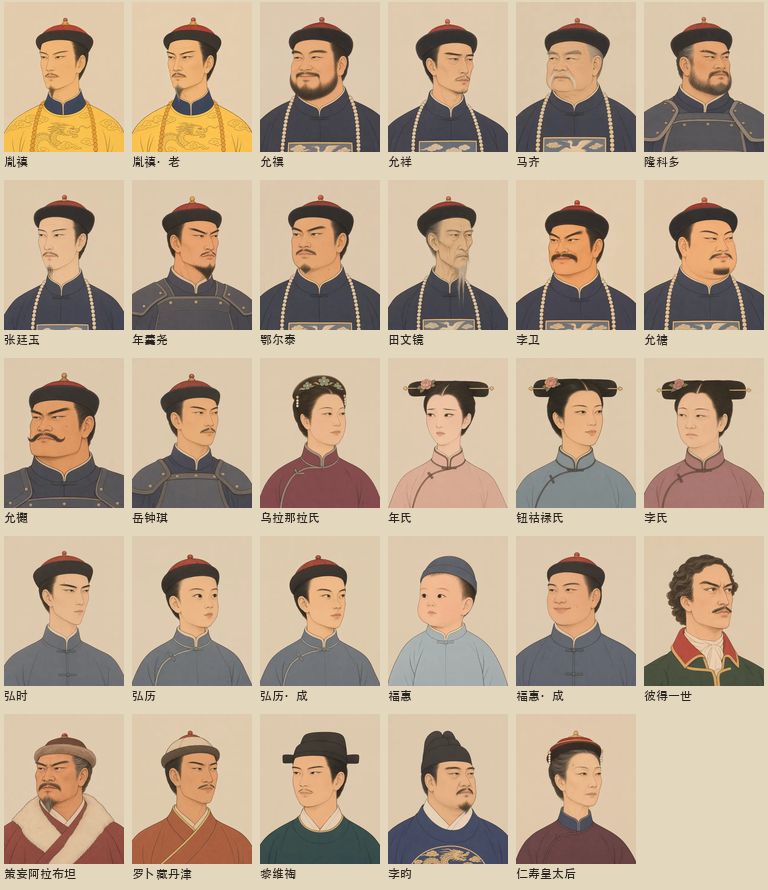

每池独立44px条：[壮官](art-phase2-review/final/qing-official-mature-44.png)、[老官](art-phase2-review/final/qing-official-old-44.png)、[武将](art-phase2-review/final/qing-general-all-44.png)、[正位](art-phase2-review/final/qing-consort-high-44.png)、[常位](art-phase2-review/final/qing-consort-regular-44.png)、[帝青](art-phase2-review/final/qing-emperor-young-44.png)、[帝老](art-phase2-review/final/qing-emperor-old-44.png)、[皇子少](art-phase2-review/final/qing-prince-teen-44.png)、[皇子成](art-phase2-review/final/qing-prince-adult-44.png)、[公主少](art-phase2-review/final/qing-princess-teen-44.png)、[公主成](art-phase2-review/final/qing-princess-adult-44.png)。本机`qa/art/`保留同样副本。

## 取图、回归与模拟

**608／608测试通过**（`npm test -- --test-concurrency=4`）。既有脸号确定性、迁移补号、同池前N人、大晟25名官员不重复、亡者占脸与其余人不换脸均通过。扩展明清四剧本开局专属像取图测试，验证同名不串剧本、皇帝39／40岁切图；新增弘历、福惠15／16岁成年切图及取图纯函数检查。雍正开局44岁按既有规则直接使用老年档，未改年龄阈值。康熙17位、雍正26位开局历史人物（含两位太后）全部有专属像。

**200年／7200旬mock无模型模拟通过**：种子`御极·两百年`，6朝、5次继位、无亡国，终局国库2040。`npm run build`成功，生成HTML **855,007字节**，低于860,000字节预算。摘要见[test-summary.json](art-phase2-review/final/test-summary.json)；完整日志留本机`qa/art/phase2-tests.log`、`phase2-simulate.log`。

## 应用内浏览器与退回

通过Codex In-app Browser访问隔离`http://127.0.0.1:4210/`。沿用第3卷雍正试读，在已确认空白的第2卷新建康熙试读；两卷保持开局0旬，未使用外部模型或覆盖玩家存档。实际实走朝堂、后宫、宗室、召见、设置和存档切换。

1280×900、768×1024、390×844均已截图；360×800下两剧本`scrollWidth=360`。实际后宫四位专属像、候选清池、宗室三皇子和仁寿皇太后均加载；朝堂可见专属卡为64×80，召见纸面120×150（手机），圆章44×44。对照条之外，折起或视口外的`loading=lazy`图片未加载属正常按需行为。详细读数见[browser-results.json](art-phase2-review/final/browser-results.json)。

| 视图 | 1280 | 768 | 390 |
| --- | --- | --- | --- |
| 康熙朝堂 | [截图](art-phase2-review/final/kangxi-court-1280.jpg) | [截图](art-phase2-review/final/kangxi-court-768.jpg) | [截图](art-phase2-review/final/kangxi-court-390.jpg) |
| 雍正后宫 | [截图](art-phase2-review/final/yongzheng-harem-1280.jpg) | [截图](art-phase2-review/final/yongzheng-harem-768.jpg) | [截图](art-phase2-review/final/yongzheng-harem-390.jpg) |
| 雍正御案 | [截图](art-phase2-review/final/yongzheng-game-1280.jpg) | [截图](art-phase2-review/final/yongzheng-game-768.jpg) | [截图](art-phase2-review/final/yongzheng-game-390.jpg) |

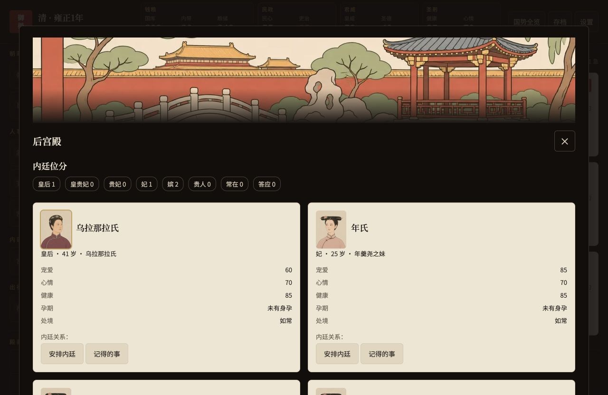

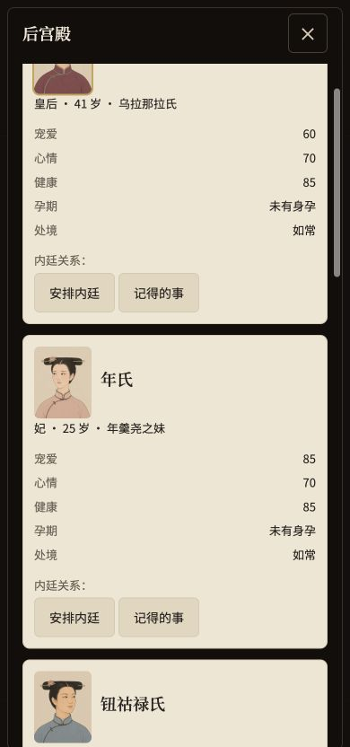

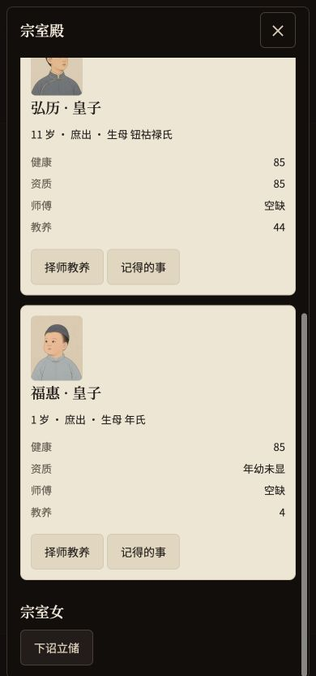

390宽召见浮层头图实测340×112，使用`audience-720.webp`、`object-fit:cover`，上下左右填满裁切区，未露源画面边缘。[行动截图](art-phase2-review/final/action-390.jpg)。

图片连接中断验收：本地服务对WebP请求直接中断连接，响应正常时设置`Cache-Control:no-store`，避免缓存掩盖失败；页面和脚本继续可读，属于**图片资源断网模拟，未做整机物理断网**。本次记录17次图片连接失败，首屏头像退回圆章、章节纯色，后宫11个人物均退回44×44首字圆章，殿阁题图纯色，文字与导航可用。中断当时读取脚本控制台无error／warn，恢复连接并刷新后正常显示。见[故障请求记录](art-phase2-review/final/offline-requests.json)。

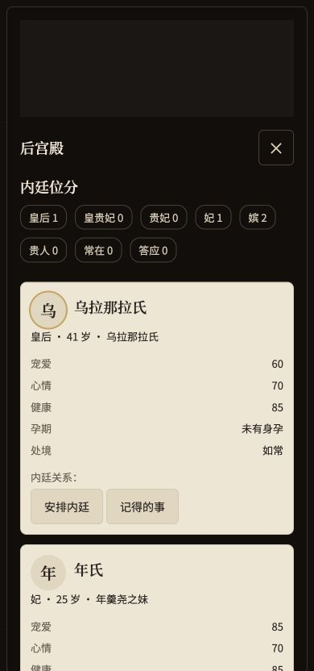

实际设置关闭「显示插图」后刷新，`art-off`保持、所有图片去掉src／srcset，后宫圆章44×44；重新勾选并刷新恢复。此设置仅存本机，不进入人物状态。验收后已恢复显示插图及默认视口。

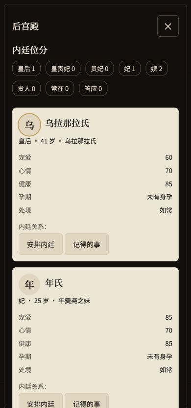

本轮不发布Pages；线上清制资源核验留待玩家验收并授权合并发布后进行。

## 请求、对比度与Lighthouse

1280×900雍正御案单次刷新新增 **4个图片请求**（章节1＋奏折上奏人3），≤6；浮层打开后按需加载。见[首屏请求明细](art-phase2-review/final/first-screen-requests.json)。

生产CSS未修改，图片底部渐变内不放文字；实际章节文字起点比图片底部低10px，无叠压。计算浏览器实际颜色：墨／纸12.34:1，淡墨／纸4.83:1，正文浅色／案面13.97:1，金／案面7.48:1，浅色／浮层15.09:1，金／浮层8.08:1，均≥4.5:1。[对比度依据](art-phase2-review/final/contrast.json)。

官方Lighthouse **13.6.0**隔离无头Chrome审计：开局页，以及大晟、万历、崇祯、康熙、雍正五个游戏首屏快照，可访问性均 **100**，无失败审计项。游戏快照由当前`renderApp`与真实初始状态生成，使用生产CSS与实际插图；实际交互另由上述应用内浏览器实走。完整JSON留本机`qa/art/`，[审计摘要](art-phase2-review/final/lighthouse-summary.json)随PR提交。

---

# 第1步定调历史记录（画风已确认，以下为当时证据）

日期：2026-11-06。分支`feat/art-phase2`，从当时最新main／`34bdb82`建立。PR #5此前已合并并成功发布；本分支[草稿PR #6](https://github.com/Lynch715/yuji-emperor/pull/6)仅供样张审阅，不合并、不发布。

**第1步完成，停在画风确认。** 当前清池4／32张、专属像0／47张，共4／79张；剩余清池28、两剧本专属47，共75张尚未生成。

## 本步资产

内置imagegen生成文官壮01、常位后妃01、正位后妃01、青年皇帝01。四张均400×500、WebP q75，单张≤30KB。文官暖帽顶珠、石青补褂、方补和朝珠；常位两把头、扁方簪花与立领旗装；正位钿子；皇帝明黄龙袍与吉服冠。全部无文字、辫子不垂胸，人物不借用演员长相。

| 清池文件 | 字节 | 帽／发顶距上沿 | 双眼高度 |
| --- | ---: | ---: | ---: |
| official-mature-01 | 9,884 | 12.07% | 37.93% |
| consort-regular-01 | 7,596 | 11.94% | 37.87% |
| consort-high-01 | 8,284 | 10.88% | 38.97% |
| emperor-young-01 | 13,648 | 12.28% | 36.99% |

头顶与双眼为人工定位，源图误差约±5px；仅裁切、等比缩放和格式转换，未修脸、调色或补画。男像先在imagegen压缩帽冠高度，女性样张采用裁切调整。裁切框、原图和尺寸明细见[asset-checks.json](art-phase2-review/asset-checks.json)。

新增4个WebP共 **39,412字节**；`assets/art/`总计 **149个WebP、2,988,572字节**（原一期145文件＋本步4文件）。原一期145文件及非清制清单保持不变。清单只填四个已出槽位，剩余槽位继续null；没有新增宦官或太后池。

PNG原图和所有首稿、修订稿均留本机`/Users/ruis/Claude/Projects/皇帝模拟器/art-source/phase2/`，仓库美术资产只收WebP。提示词、四张长相卡与清制服饰共同约束见[ART-PROMPTS](ART-PROMPTS.md)。青年皇帝是28岁虚构池图；康熙7岁、雍正44岁等剧本专属像在画风确认后另画。

## 参照图传入方式

内置工具最多接收5个参照文件；直接传8张被拒绝，未生成图。已先在草稿PR说明：一期4张、清制4张分别等比缩放拼成一块参照板，完整保留八张画面；编辑时再传单独目标。本步两张男像修订已使用两板＋目标；后续每次调用同样传入一期板和确认后的清制板。参照板只排布缩放，不修图，不减少参考内容。定调单张生成；确认后的池图继续同池2×2，专属单张。

## 对照与浏览器

完整样张及44px圆章顺序均为：文官壮、常位后妃、正位后妃、青年皇帝。各池目前只有1张，全池任意两脸四维差异、每剧本44px排查在批量阶段执行。

本地`qa/art/`同时保留各池44px条，仓库副本在`docs/art-phase2-review/qing-*-44.png`。构图线仅用于验收叠层，游戏资产不带线。

应用内浏览器经`http://127.0.0.1:4210`验收：四类综合对照页使用生产`portraitHTML`、`sceneHTML`、CSS与插图事件处理，纸面像桌面200×250、390宽120×150，圆章44×44；所有图片成功加载。此页为只读池图展示，不读写存档。

真实游戏另在该隔离端口的空白第3卷开启雍正试读，实走朝堂和后宫；允禩暂取文官池01，乌拉那拉氏、年氏暂取正位／常位池01，64×80卡片正常。后续专属像完成后会按既有优先级覆盖。1280×900、390×844均截图；360×800下综合页和真实游戏`scrollWidth=360`，脚本错误为空。未调用外部模型，未覆盖玩家旧档。读数见[browser-results.json](art-phase2-review/browser-results.json)。

综合页关闭「显示插图」后，全部图片去掉src并隐藏，纸面像退回44px圆章、场景隐藏；重新开启恢复，截图如下。完整二期的断网与设置交互验收在收尾执行。

## 阶段检查与后续边界

- `npm test -- --test-concurrency=4`：607／607通过；既有清单核对更新为一期145文件＋本步4文件，覆盖迁移、确定性脸号、避让和旧档原骰。引擎和存档版本未改，仍v25。
- `npm run build`：98模块，790,153字节脚本；index.html由构建脚本生成。
- `npm run simulate -- 200`：200年／7200旬，5次继位、0亡国、终局国库2040；摘要见[simulate-200-summary.json](art-phase2-review/simulate-200-summary.json)，测试日志见[npm-test.log](art-phase2-review/npm-test.log)。
- 本步完成构图、44px裁切、文件预算、真实取图、关闭插图回退及360布局。待画风确认并补齐75张后，再做§9完整收尾：各池／两剧本撞脸检查、开局专属全覆盖、三档截图、断网、对比度、Lighthouse和最终总量预算。本步不把这些整批项目记为通过。

现在停止生成，等待玩家确认这四张清制画风；草稿PR不合并、不部署。原目录海报与其他未提交文件保留。
