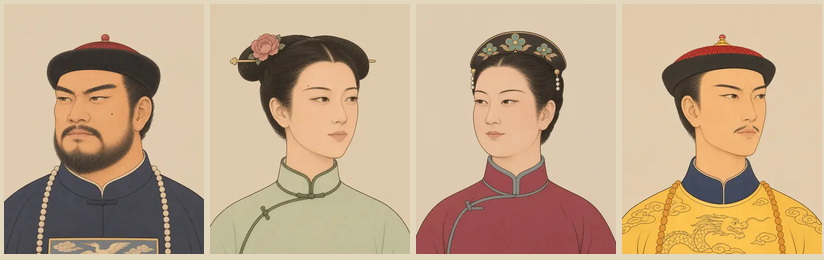
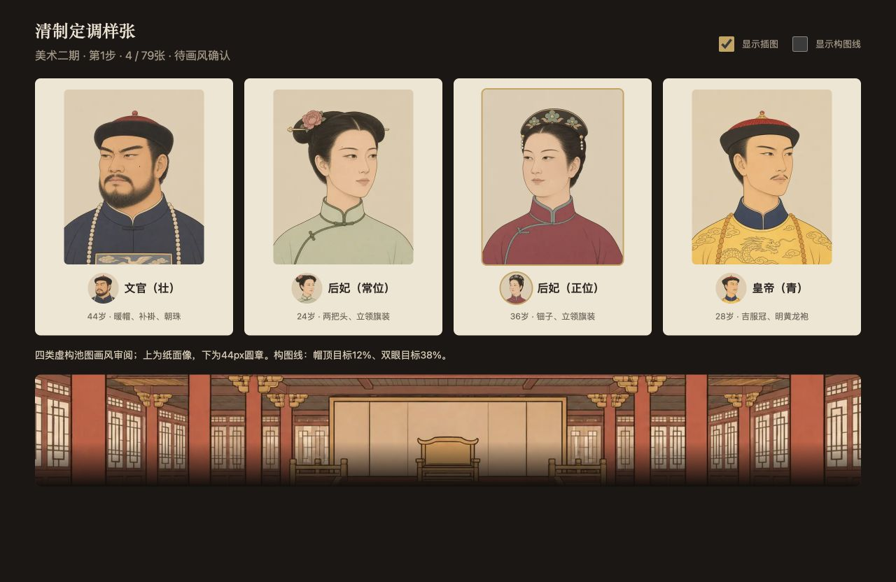
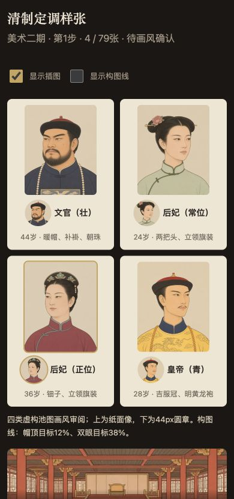
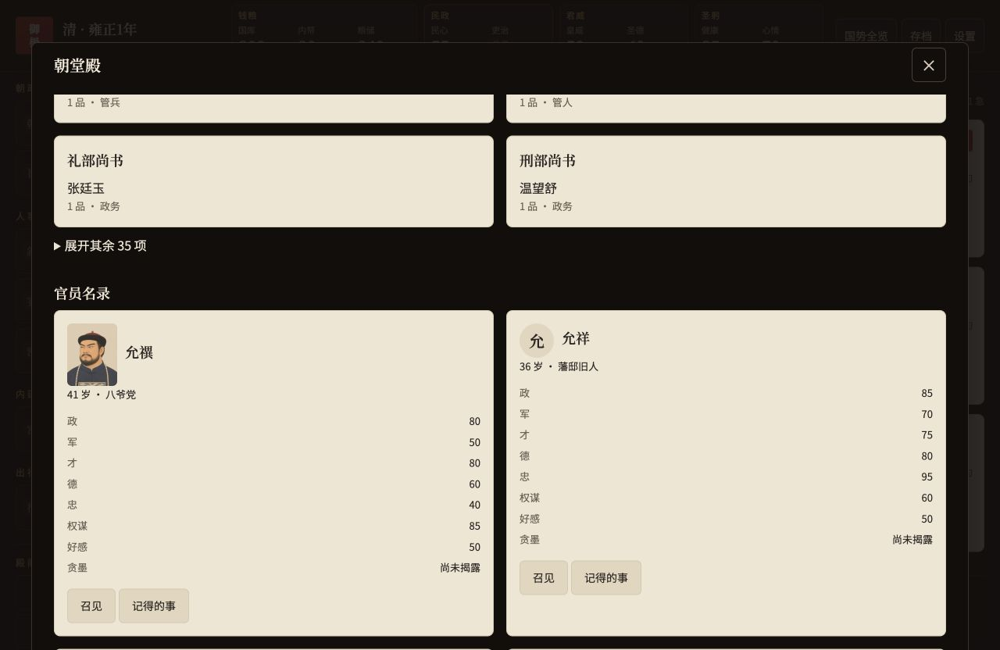
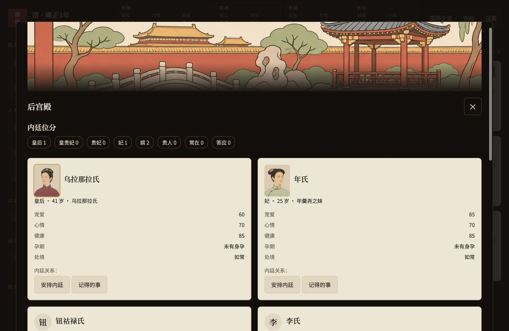
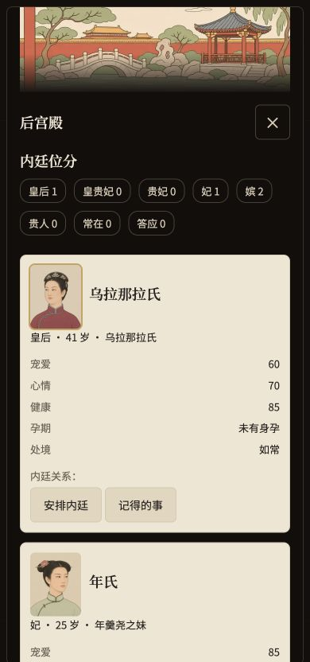
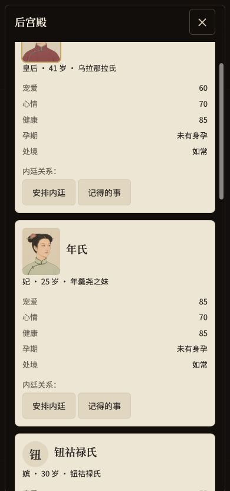
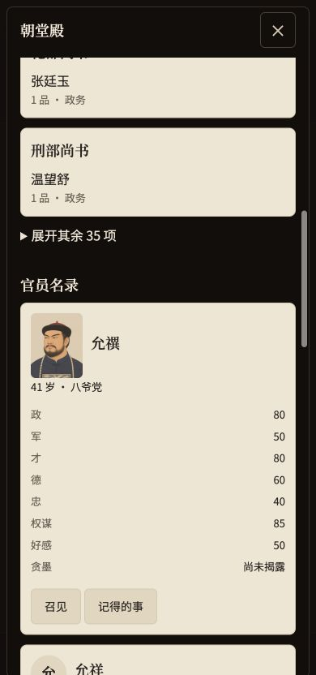
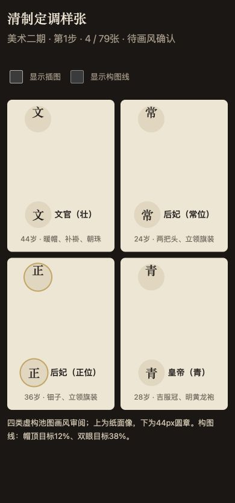

# 美术二期 · 清制 · 第1步定调样张

日期：2026-11-06。分支`feat/art-phase2`，从当时最新main／`34bdb82`建立。PR #5此前已合并并成功发布；本分支[草稿PR #6](https://github.com/Lynch715/yuji-emperor/pull/6)仅供样张审阅，不合并、不发布。

**第1步完成，停在画风确认。** 当前清池4／32张、专属像0／47张，共4／79张；剩余清池28、两剧本专属47，共75张尚未生成。

## 本步资产

内置imagegen生成文官壮01、常位后妃01、正位后妃01、青年皇帝01。四张均400×500、WebP q75，单张≤30KB。文官暖帽顶珠、石青补褂、方补和朝珠；常位两把头、扁方簪花与立领旗装；正位钿子；皇帝明黄龙袍与吉服冠。全部无文字、辫子不垂胸，人物不借用演员长相。

| 清池文件 | 字节 | 帽／发顶距上沿 | 双眼高度 |
| --- | ---: | ---: | ---: |
| official-mature-01 | 9,884 | 12.07% | 37.93% |
| consort-regular-01 | 7,596 | 11.94% | 37.87% |
| consort-high-01 | 8,284 | 10.88% | 38.97% |
| emperor-young-01 | 13,648 | 12.28% | 36.99% |

头顶与双眼为人工定位，源图误差约±5px；仅裁切、等比缩放和格式转换，未修脸、调色或补画。男像先在imagegen压缩帽冠高度，女性样张采用裁切调整。裁切框、原图和尺寸明细见[asset-checks.json](art-phase2-review/asset-checks.json)。

新增4个WebP共 **39,412字节**；`assets/art/`总计 **149个WebP、2,988,572字节**（原一期145文件＋本步4文件）。原一期145文件及非清制清单保持不变。清单只填四个已出槽位，剩余槽位继续null；没有新增宦官或太后池。

PNG原图和所有首稿、修订稿均留本机`/Users/ruis/Claude/Projects/皇帝模拟器/art-source/phase2/`，仓库美术资产只收WebP。提示词、四张长相卡与清制服饰共同约束见[ART-PROMPTS](ART-PROMPTS.md)。青年皇帝是28岁虚构池图；康熙7岁、雍正44岁等剧本专属像在画风确认后另画。

## 参照图传入方式

内置工具最多接收5个参照文件；直接传8张被拒绝，未生成图。已先在草稿PR说明：一期4张、清制4张分别等比缩放拼成一块参照板，完整保留八张画面；编辑时再传单独目标。本步两张男像修订已使用两板＋目标；后续每次调用同样传入一期板和确认后的清制板。参照板只排布缩放，不修图，不减少参考内容。定调单张生成；确认后的池图继续同池2×2，专属单张。

## 对照与浏览器

完整样张及44px圆章顺序均为：文官壮、常位后妃、正位后妃、青年皇帝。各池目前只有1张，全池任意两脸四维差异、每剧本44px排查在批量阶段执行。

本地`qa/art/`同时保留各池44px条，仓库副本在`docs/art-phase2-review/qing-*-44.png`。构图线仅用于验收叠层，游戏资产不带线。

应用内浏览器经`http://127.0.0.1:4210`验收：四类综合对照页使用生产`portraitHTML`、`sceneHTML`、CSS与插图事件处理，纸面像桌面200×250、390宽120×150，圆章44×44；所有图片成功加载。此页为只读池图展示，不读写存档。

真实游戏另在该隔离端口的空白第3卷开启雍正试读，实走朝堂和后宫；允禩暂取文官池01，乌拉那拉氏、年氏暂取正位／常位池01，64×80卡片正常。后续专属像完成后会按既有优先级覆盖。1280×900、390×844均截图；360×800下综合页和真实游戏`scrollWidth=360`，脚本错误为空。未调用外部模型，未覆盖玩家旧档。读数见[browser-results.json](art-phase2-review/browser-results.json)。

综合页关闭「显示插图」后，全部图片去掉src并隐藏，纸面像退回44px圆章、场景隐藏；重新开启恢复，截图如下。完整二期的断网与设置交互验收在收尾执行。

## 阶段检查与后续边界

- `npm test -- --test-concurrency=4`：607／607通过；既有清单核对更新为一期145文件＋本步4文件，覆盖迁移、确定性脸号、避让和旧档原骰。引擎和存档版本未改，仍v25。
- `npm run build`：98模块，790,153字节脚本；index.html由构建脚本生成。
- `npm run simulate -- 200`：200年／7200旬，5次继位、0亡国、终局国库2040；摘要见[simulate-200-summary.json](art-phase2-review/simulate-200-summary.json)，测试日志见[npm-test.log](art-phase2-review/npm-test.log)。
- 本步完成构图、44px裁切、文件预算、真实取图、关闭插图回退及360布局。待画风确认并补齐75张后，再做§9完整收尾：各池／两剧本撞脸检查、开局专属全覆盖、三档截图、断网、对比度、Lighthouse和最终总量预算。本步不把这些整批项目记为通过。

现在停止生成，等待玩家确认这四张清制画风；草稿PR不合并、不部署。原目录海报与其他未提交文件保留。
