# 美术三期 · 汉、唐、宋验收

## 汉制发布前两张修订 · 2026-11-09

玩家已验收汉制53张，并授权本轮修订后合并发布。本轮恰好替换**窦婴、董仲舒2张专属像**，其余388个WebP逐字节保持；全部src与HTML共108个文件与已验收`2f882b6`相同，存档仍v25。当前本地验收已完成；合并、Pages部署及线上390文件核对完成后在本节补充发布结果。

- 窦婴仍50岁、原长方骨相与朝右姿态，增加灰鬓、额纹和眼周成熟纹理，改为垂至上胸的黑灰宽长髯，与韩安国短方颏须拉开。
- 董仲舒仍39岁、朝右、深青宽黑领缘交领，改清瘦成年男性书生、细长颈肩，完全无须，与赵绾三绺稀疏长须、紧蹙眉目分开。仅调整美术长相卡，不更改剧本年龄或游戏数值。

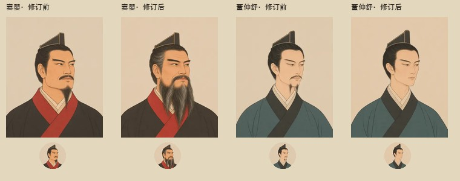

[完整专属图册](art-phase3-han-review/revision-20261109-release/han-wudi-full.png) · [当前长相卡](art-phase3-han-review/revision-20261109-release/face-cards.json) · [构图与散列](art-phase3-han-review/revision-20261109-release/asset-checks.json) · [替换范围与源码逐字节检查](art-phase3-han-review/revision-20261109-release/revision-scope.json)。两张用内置imagegen逐张修订，每次传一期完整四图板＋汉制完整四图板＋本人目标；提示词先记ART-PROMPTS，原PNG仅保留本机art-source，导出只裁切、等比缩放及WebP编码。

两张400×500／q75，冠顶10.84–12.84%、双眼39.77–39.87%，分别8,814与5,958字节。汉制仍53张，共439,232字节；assets/art总计**390个WebP／5,059,892字节**。377张原画加13个场景720派生档的口径保持。

本轮重新运行**609／609测试、200年／7200旬无模型模拟及构建**，均通过，模拟6朝、终局国库2040。HTML854,145字节且SHA-256保持；本轮仅资产与文档变化，沿用下方2f882b6全量验收的退回、对比度及六次Lighthouse100证据，没有宣称重跑Lighthouse。[测试摘要](art-phase3-han-review/revision-20261109-release/test-summary.json) · [模拟完整结果](art-phase3-han-review/revision-20261109-release/simulation-200y.json)。

应用内浏览器在独立localhost4219试读局仅打开真实朝堂及窦婴、董仲舒召见，未垂询或推进旬；两对人物生产取图只读图册12实例全部400×500加载。1280纸面200×250、390纸面120×150，圆章44×44，360无溢出，console warn／error为空。[本轮浏览器读数](art-phase3-han-review/revision-20261109-release/local-browser.json)。

| 本轮截图 | 1280 | 390 |
| --- | --- | --- |
| 两对人物生产取图图册 | [桌面](art-phase3-han-review/revision-20261109-release/local-gallery-1280.jpg) | [手机](art-phase3-han-review/revision-20261109-release/local-gallery-390.jpg) |
| 窦婴真实召见 | [桌面](art-phase3-han-review/revision-20261109-release/local-dou-paper-1280.jpg) | [手机](art-phase3-han-review/revision-20261109-release/local-dou-paper-390.jpg) |
| 董仲舒真实召见 | — | [手机](art-phase3-han-review/revision-20261109-release/local-dong-paper-390.jpg) |

以下为53张全量验收的历史记录，当时为草稿PR；最终发布状态以本节后续记录为准。

---

## 三期第三批 · 汉制53张完成 · 2026-11-09

玩家已确认汉制画风，本轮补齐余49张，并加强文官壮01的进贤冠斜梁。当前**53／53张：汉池33＋汉武帝专属20**。分支`feat/art-phase3-han`，最新main基准`dbffc28`；更新同一[草稿PR #9](https://github.com/Lynch715/yuji-emperor/pull/9)，**不合并、不发布Pages**。下方定调第1步与宋、唐记录为历史记录。

### 造型、长相卡与44px复检

- 所有汉制采用交领右衽、宽深色领缘；文官进贤冠前高后低，上梁约30–40°下降；文官壮01保留本人长相，只加强冠形。武将用长条札甲、武冠或鹖冠；皇帝玄袍红缘、通天冠与金博山；正位步摇、常位简簪。其余三张已确认定调图逐字节保持。
- 每池先写8维长相卡，74组同池两两比较均至少4维不同，且脸型或须形／发际线不同。初检将文官壮02改为短宽矩形上唇须、下巴无须，09保持无须并加强成年男性眉骨、下颌与鬓发；复检男女、年龄和44px轮廓。
- 刘彻按开局16岁少年绘制，另出本人50岁变体，保留骨相与右颊痣；陈阿娇18岁、卫子夫17岁，后者衣饰朴素；窦太皇太后约65岁、灰鬓闭目；王臧50岁为有须文官；李广44岁修长、程不识45岁严整；赵佗约90岁、白发白须椎髻。其余人物依据scenarios.js性格、秘密与史书事迹定卡；无明确记载的五官、须形与痣为辨识设计，不冒称真实容貌。

所有批量与修订使用内置imagegen，均传一期完整四图板＋汉制完整四图板；池图按同池2×2生成、空余格留空，专属单张，构图未过的稿单独校正。原PNG与未选稿仅留本机`art-source/phase3-han`；本地导出只裁切、等比缩放、WebP编码，没有手工修脸、填边或调色。全部长相卡、服饰共同约束、史书链接与实际提示词见[ART-PROMPTS](ART-PROMPTS.md)。

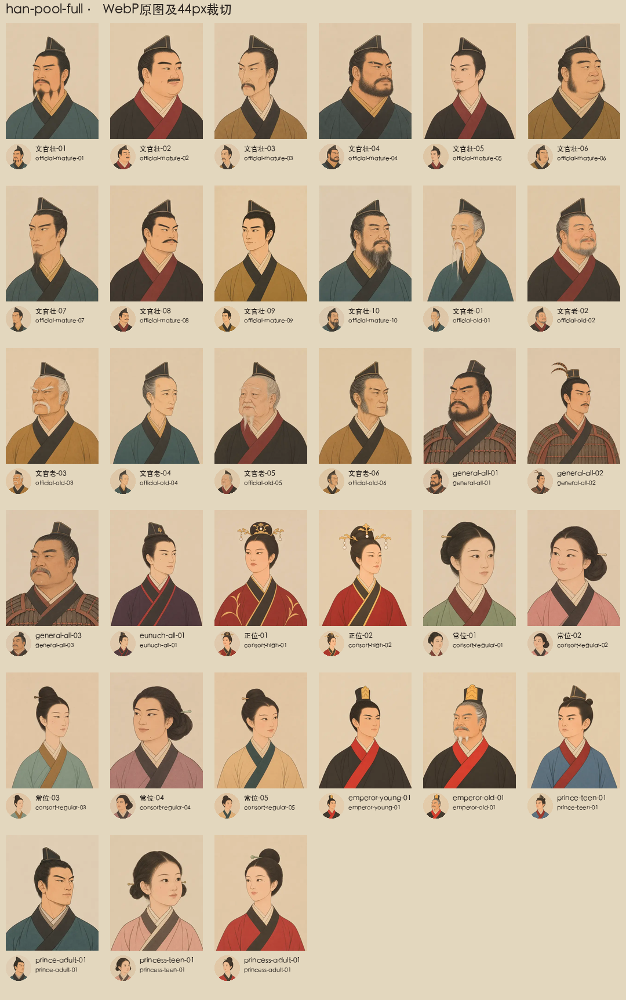

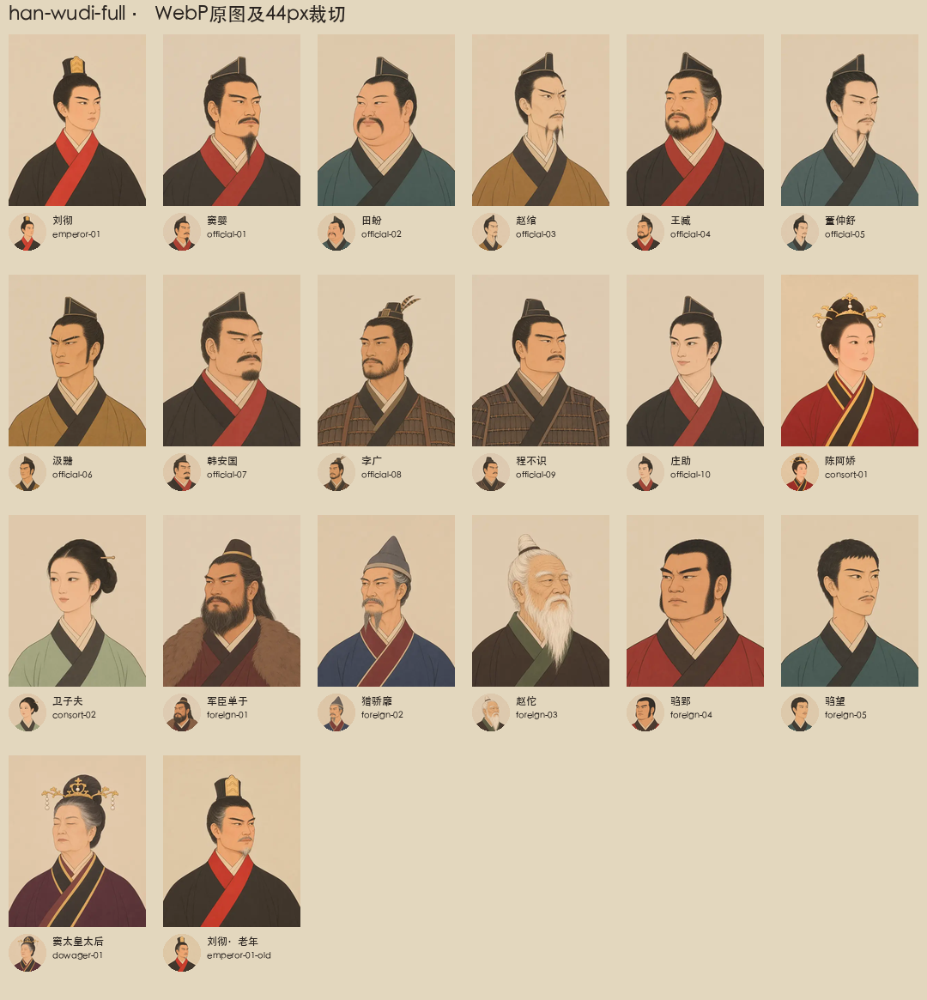

[本轮冠形与男性特征前后对照](art-phase3-han-review/final/revision-before-after.jpg) · [汉池33张44px总条](art-phase3-han-review/final/han-pool-44.png) · [刘彻本人年龄对照](art-phase3-han-review/final/age-variants.png) · [全部长相卡](art-phase3-han-review/final/face-cards.json) · [视觉终检](art-phase3-han-review/final/visual-review.json)。12个池各自的44px条已存本机`qa/art/`，并附在[池条目录](art-phase3-han-review/final/pools)。完整冠髻顶**10.00–14.00%**，双眼**36.01–40.00%**，全部400×500、q75，最大单张15,544字节；[逐文件坐标、散列及74组卡差异](art-phase3-han-review/final/asset-checks.json)。

### 取图、回归与体积

汉池33槽与汉武帝20槽全部填入，汉武帝开局19人优先取本人专属，刘彻40岁切换本人老年像。汉制郎中令下标8取文官、中书谒者令下标10取宦官的修正与Node回归保留。七剧本共142位不同历史开局人物均命中专属；宋、万历、康熙的皇帝另有同名皇嗣记录，按同一姓名合并计人，实际逐条检查145条。

为守原单文件HTML预算，已先在PR说明原因，再将连续编号池路径由逐字面列举改为本模块纯函数`numberedPool`展开；最终导出的映射值、顺序与路径不变。非汉全部清单值深比较相同，原337个非汉WebP逐字节保持，场景、殿阁与焦点保持。[清单、七剧本逐人与377口径核对](art-phase3-han-review/final/manifest-and-377-inventory.json)。

本轮**609／609测试、200年／7200旬无模型模拟、构建全部通过**。模拟6朝、终局国库2040，无结局中断；HTML **854,145字节＜860,000**，未放宽门槛。与main相比core、LLM和CSS共65个文件逐字节保持，存档仍v25。[测试与构建摘要](art-phase3-han-review/final/test-summary.json) · [200年模拟完整结果](art-phase3-han-review/final/200-year-simulation.json)。

汉制53张合计**438,218字节**；全目录**390个WebP／5,058,878字节（5.06MB，低于12MB）**。ART-SPEC §6的377为原画：池207＋专属154＋场景13＋殿阁3；13个场景另有720派生档，因此**377张原画＋13派生文件＝390个WebP**，全套原画数量与规范一致。

### 三档浏览器、退回与可访问性

新版应用内浏览器在独立`localhost:4219`空卷1试读汉武帝开局；只打开朝堂、王臧召见纸面、后宫、设置，未垂询、未安排动作或推进旬，请求统计0次。不访问正式站点，不触碰私人存档。真实两位后妃使用专属01／02；王臧真实纸面为文官专属04。

| 截图 | 1280 | 768 | 390 |
| --- | --- | --- | --- |
| 真实开局 | [桌面](art-phase3-han-review/final/opening-1280.jpg) | [平板](art-phase3-han-review/final/opening-768.jpg) | [手机](art-phase3-han-review/final/opening-390.jpg) |
| 真实朝堂 | [桌面](art-phase3-han-review/final/court-1280.jpg) | [平板](art-phase3-han-review/final/court-768.jpg) | [手机](art-phase3-han-review/final/court-390.jpg) |
| 王臧真实召见 | [桌面](art-phase3-han-review/final/paper-1280.jpg) | [平板](art-phase3-han-review/final/paper-768.jpg) | [手机](art-phase3-han-review/final/paper-390.jpg) |
| 真实后宫 | [桌面](art-phase3-han-review/final/harem-1280.jpg) | [平板](art-phase3-han-review/final/harem-768.jpg) | [手机](art-phase3-han-review/final/harem-390.jpg) |
| 53张生产取图只读图册 | [桌面](art-phase3-han-review/final/gallery-1280.jpg) | [平板](art-phase3-han-review/final/gallery-768.jpg) | [手机](art-phase3-han-review/final/gallery-390.jpg) |

浏览器原生截图为JPEG，三档开局另转存本机`qa/art-han-{1280,768,390}.png`。图册仅以显示用状态覆盖池索引，调用生产`portraitSource`、`portraitHTML`及CSS，不读写游戏存档；53图×纸面、圆章、卡片＝159个实例，在三档均400×500全部加载。纸面桌面200×250、手机120×150，圆章44×44；游戏和图册360宽均scrollWidth360。手机行动头图实际**340×112**，audience-720、cover，裁切不露边。[浏览器完整读数](art-phase3-han-review/final/browser-results.json)。

- 仅断开WebP图片请求，HTML／JS照常：章节头退纯色，王臧纸面退44×44圆章，浏览器warn／error为空；[开局退回](art-phase3-han-review/final/images-offline-1280.jpg)、[纸面退回](art-phase3-han-review/final/images-offline-paper-390.jpg)。
- 关闭「显示插图」后刷新，图片无src，陈／卫回44×44首字圆章；[关闭后的开局](art-phase3-han-review/final/illustrations-off-1280.jpg)、[后宫](art-phase3-han-review/final/illustrations-off-harem-390.jpg)。最后恢复开启并确认4个开局图片实例正常，图册159实例正常；临时断图开关已移除。
- 1280视口稳定后独立刷新，首屏**3次图片请求≤6**，[请求明细](art-phase3-han-review/final/first-screen.json)。朝堂、后宫、召见的头图渐变仅落在无文字图片区，文字在下方独立纯色区；本轮DOM计算的纸面／后宫文字最低**4.83:1**，无低于适用门槛的文字。
- 官方Lighthouse13.6.0重新审计生产样式的朝堂、后宫和召见只读投影，1280／390共**六次可访问性均100≥95**；真实操作另由应用内浏览器实走。[六次审计摘要](art-phase3-han-review/final/lighthouse-summary.json)。本轮不沿用前批分数。

Pages线上抽查在玩家验收并授权合并发布后执行；本轮保持草稿PR，不合并、不部署。

---

## 三期第三批 · 汉制定调第1步 · 2026-11-09

基准最新main `dbffc28`，分支`feat/art-phase3-han`。本步已修宦官分池并完成**4／53张定调池图**：文官壮、常位后妃、正位后妃、皇帝青各01，均已接入游戏。**停在第1步等玩家确认；余49张未生成，不合并、不发布。** 本步交付为草稿PR，历史宋、唐验收记录保留在下方。

### 汉制官职分池修正

`src/ui/art.js`改为汉制下标10中书谒者令取宦官池，下标8郎中令取文官池；唐／宋／明仍8取宦官，清8仍按文官，大晟保持明制。王臧50岁郎中令现在命中`han/official-mature`。新增一条Node测试，含实际王臧与七剧本／大晟的8、10两职探针，保证纯函数不改人物或官职。按本轮玩家明确指示同步ART-SPEC §3.2旧表，不改引擎、官职数组或存档v25。

### 四张样张与五朝对照

四张种子逐张用内置imagegen生成，初次传一期完整四图板；出齐即拼汉制板，后续构图修订同时传一期四图＋汉四图＋本人目标。原稿PNG和未选稿只留本机`art-source/phase3-han`。规范未过的稿未接入，最终只裁切、等比缩放与WebP编码，没有手工修脸或调色。确认后其余池仍按同池2×2、专属单张。

- 文官：深青交领、宽黑缘，前高后低斜梁进贤冠；正面无补子、无圆领、无幞头／展角。
- 常位：17岁少女绘制档、堕马侧髻、单簪、朴素浅绿曲裾交领；正位18岁少女绘制档、更高宽髻、金枝垂珠步摇、深朱曲裾。两档在44px有明确头饰轮廓差异。
- 青帝：16岁少年绘制档、无须，玄袍红领缘、通天冠与冠前金博山，和文官黑色斜梁冠分开。当前开局三人使用池图；刘彻、陈阿娇、卫子夫的正式历史专属仍按各自资料在第2步另绘，不把池长相卡冒充专属卡。

共同汉制服饰约束、年龄／外邦要求和全部实际提示词已记[ART-PROMPTS](ART-PROMPTS.md)。四张完整冠髻顶**10.00–12.69%**，双眼**37.09–39.99%**；朝向2左／2右；400×500、q75、各≤30KB。

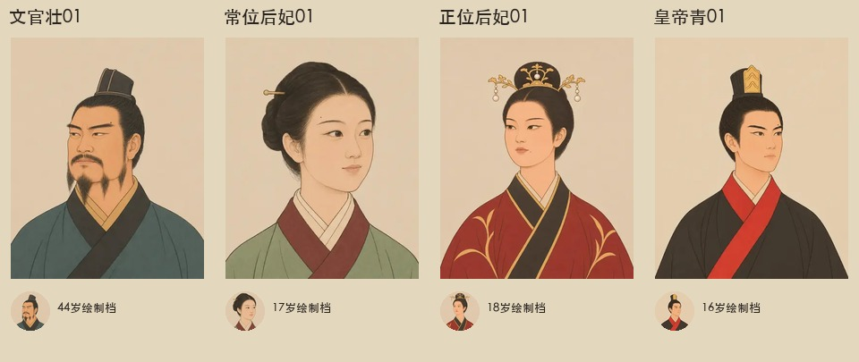

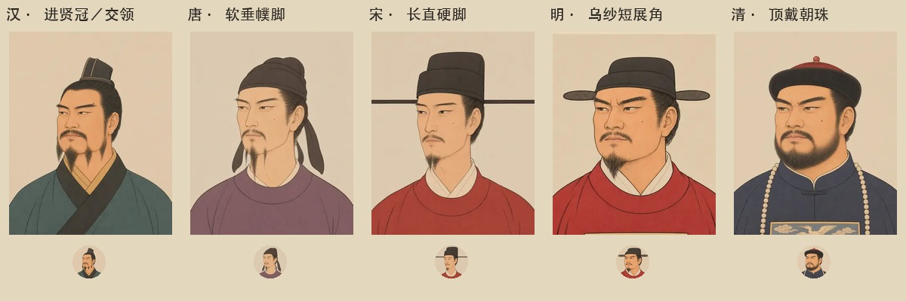

[逐文件构图、字节与散列](art-phase3-han-review/tone/asset-checks.json)。每池当前只有1张样张，完整同池查重与20张专属同剧本条在后续完成；四张条和逐池单张条也存本机`qa/art/`。

### 本步测试与浏览器

本轮**609／609测试、200年／7200旬无模型模拟、构建通过**；模拟6朝，终局国库2040。HTML **859,777字节**，仍低于原860,000字节预算；没有放宽测试门槛。core、LLM、CSS、其他朝代清单与前批337个WebP保持，存档v25。[测试与构建摘要](art-phase3-han-review/tone/test-summary.json) · [200年模拟完整结果](art-phase3-han-review/tone/200-year-simulation.json)。

应用内浏览器使用独立`localhost:4217`空卷1，汉武帝试读0旬，仅打开开局、朝堂、后宫、设置，未安排动作或推进旬，请求统计0次；不触碰正式站点和私人存档。开局取青年皇帝池01，窦婴名册取文官壮01，陈阿娇与卫子夫分别取正位／常位01；未出图位置照常退回圆章。四张生产取图／CSS只读图册12个纸面、人物卡、圆章实例均400×500加载；1280纸面200×250，390纸面120×150，圆章44×44。游戏与图册360宽均scrollWidth=360，无横向溢出。

关闭插图后刷新，后妃图片无src、opacity0，退回44×44首字圆章；最后恢复开启。console warn／error均空。[浏览器读数](art-phase3-han-review/tone/browser-results.json)。1280首屏独立刷新记录3次图片请求，≤6，[请求明细](art-phase3-han-review/tone/first-screen.json)。

| 本步截图 | 1280 | 390 |
| --- | --- | --- |
| 真实汉武帝开局预览 | [桌面](art-phase3-han-review/tone/opening-1280.jpg) | [手机](art-phase3-han-review/tone/opening-390.jpg) |
| 真实后宫 | [桌面](art-phase3-han-review/tone/harem-1280.jpg) | [手机](art-phase3-han-review/tone/harem-390.jpg) |
| 四张生产取图只读图册 | [桌面](art-phase3-han-review/tone/samples-1280.jpg) | [手机](art-phase3-han-review/tone/samples-390.jpg) |

另有[真实朝堂1280](art-phase3-han-review/tone/court-1280.jpg)、[关闭插图退回](art-phase3-han-review/tone/illustrations-off.jpg)。本步没有宣称完整§9已收尾：余49张、开局19人专属、完整768三档、图片断连、对比度与Lighthouse全量复验在确认画风并补齐后执行；代码与HTML有变，不沿用宋制Lighthouse分数冒作本轮结果。

### 实际数量与377张口径

本步新增4个WebP，共**32,202字节**；`assets/art/`累计**341文件／4,652,862字节（约4.65MB）**，原337文件逐字节相同。清单只填四个汉池01槽，其余29个汉池槽与20个专属槽保留空位；其他朝代、场景／殿阁和焦点不变。

§6的**377张是原画／逻辑资产数**：池207＋专属154＋场景13＋殿阁3。13场景各有1440、720两档，720派生档另13个文件，因此全部完成应为**377＋13＝390个WebP**，不能把390文件误报为多画13张。本步完成逻辑资产328、实体341文件，尚缺49张汉制原画；328＋49＝377，341＋49＝390。[清单、文件与377核对](art-phase3-han-review/tone/manifest-and-377-inventory.json)。

---

## 宋制发布与最终四张修订 · 2026-11-09

玩家已验收51张并授权本轮修订后合并发布。本轮恰好替换**刘太后、丁谓、钱惟演、范仲淹4张专属像**，其他333个WebP逐字节保持；HTML及core／LLM／UI共103个文件与已验收98cffe1相同，存档仍v25。已按玩家授权合并[PR #8](https://github.com/Lynch715/yuji-emperor/pull/8)到main，合并提交`8457e0a`；[GitHub Pages测试、构建与部署全部成功](https://github.com/Lynch715/yuji-emperor/actions/runs/42623964628)，线上验证如下。

- 刘太后按开局53岁画成五十多岁的端庄妇人：补成熟面颊、眼周与口周，保持花钗冠、额头及双颊珍珠妆、紫袍与朝右姿态。
- 丁谓56岁改为长宽方脸、花白短满须与明显银白鬓发；钱惟演45岁收窄菱形脸、三绺细长黑须与细长颈肩，神情文雅谨慎；范仲淹33岁改清瘦长脸、黑鬓无须、挺直颈肩与清癯刚直神情。三人不靠袍色区分，完整18张专属44px条已重新检查。

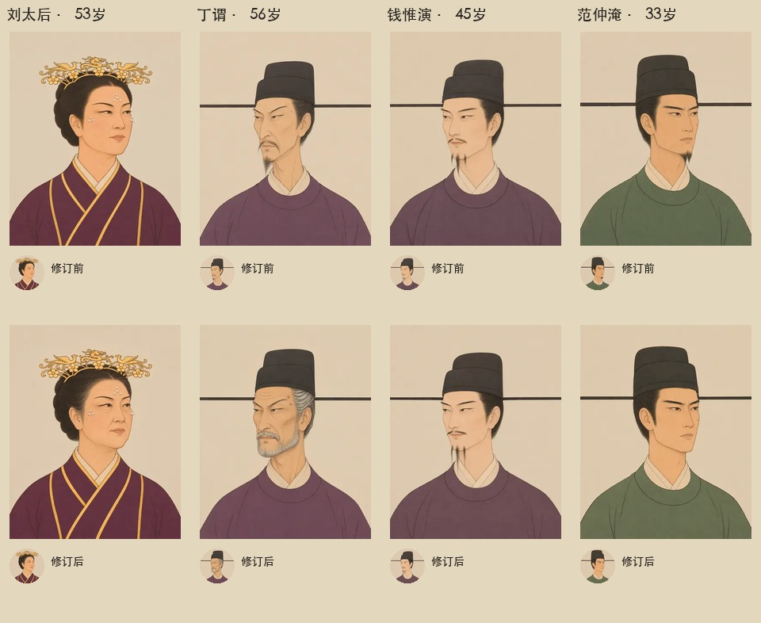

[完整专属图册](art-phase3-song-review/revision-20261109-release/song-renzong-full.png) · [当前长相卡](art-phase3-song-review/revision-20261109-release/face-cards.json) · [资产与构图](art-phase3-song-review/revision-20261109-release/asset-checks.json) · [替换范围与源码散列检查](art-phase3-song-review/revision-20261109-release/revision-scope.json)。四张用内置imagegen逐张修订，每次传入一期四图板＋宋制四图板＋本人现图，PNG只保留本机art-source；提示词已在生成前写入ART-PROMPTS。导出仅裁切、等比缩放与WebP编码，没有手工修脸或调色。

宋制仍51张，共**411,388字节**；assets/art全目录**337个WebP／4,620,660字节（约4.62MB）**。全部400×500、q75、单张≤30KB；四张帽冠顶10.00–12.84%、双眼37.54–40.00%，不放宽§7构图线。前批286张和三张非皇帝宋制定调图保持；宋17位开局历史人物仍全部命中专属像，[取图逐人复验](art-phase3-song-review/revision-20261109-release/manifest-checks.json)。

本轮重新运行**608／608测试、200年／7200旬无模型模拟、构建**，均通过。[测试摘要](art-phase3-song-review/revision-20261109-release/test-summary.json) · [模拟完整结果](art-phase3-song-review/revision-20261109-release/simulation-200y.json)。本轮仅四张资产与文档改变，HTML和CSS逐字节保持，沿用下方全量验收中的断图／关闭插图、对比度6.99:1及六次官方Lighthouse可访问性100证据，没有声称重新跑Lighthouse。

应用内浏览器在独立localhost4216空卷1做宋仁宗试读：实际朝堂丁谓与召见纸面加载正常，未垂询、未推进旬；四位真实历史人物的生产取图与CSS只读图册共12个实例全部400×500加载，1280纸面200×250、390纸面120×150、圆章44×44，390无横向溢出。手机行动头图实际340×112、audience-720／cover，裁切不露边。console warn／error为空。[本轮浏览器读数](art-phase3-song-review/revision-20261109-release/local-browser.json)。

| 本轮截图 | 1280 | 390 |
| --- | --- | --- |
| 真实朝堂 | [朝堂](art-phase3-song-review/revision-20261109-release/local-court-1280.jpg) | [朝堂](art-phase3-song-review/revision-20261109-release/local-court-390.jpg) |
| 四位历史人物生产取图只读图册 | [图册](art-phase3-song-review/revision-20261109-release/local-gallery-1280.jpg) | [图册](art-phase3-song-review/revision-20261109-release/local-gallery-390.jpg) |
| 丁谓真实召见纸面 | — | [纸面](art-phase3-song-review/revision-20261109-release/local-paper-390.jpg) |

### 线上发布与只读抽查

正式站点：[御极](https://lynch715.github.io/yuji-emperor/)。合并提交`8457e0a45247f235c14294c50bbd2bd5b371a884`与已测试分支头`0aa5fc828d86f11939d742907b2e5277289512bc`的src、HTML及assets/art完全相同。部署工作流`42623964628`的测试、构建与Pages deploy均success，[提交及工作流记录](art-phase3-song-review/revision-20261109-release/release-status.json)。

发布后下载正式URL的HTML及全部337张WebP，**338／338项HTTP200且SHA-256与合并版本完全一致**，包括刘太后和三位文官。HTML859,561字节，SHA-256为`ea60ef01bc5791456cea55ef110c752dcc49d6ec54a33393650d970cd4b54497`。[逐文件HTTP、大小与散列](art-phase3-song-review/revision-20261109-release/pages-all-hashes.json)。

应用内浏览器在正式站点**仅预览宋仁宗开局，没有按“承天践祚”或切换存档**。赵祯12岁专属像在1280／390均400×500加载，显示64×80；390无溢出，court-720头图318×112。另直接打开正式路径丁谓与刘太后WebP，均400×500完成加载，分别可见花白鬓须和五十多岁花钗冠珍珠妆。[线上浏览器读数](art-phase3-song-review/revision-20261109-release/online-browser.json)。

此次**发布完成后的只读预览前后**，现有第3卷万历0旬的UI导出均36,366字节、SHA-256相同；第1／第2卷仍空，未新建或推进旬、未改变插图设置。这是本轮线上抽查前后证明，不冒称发布前的导出基准。原存档内容只留本机，仓库仅记字节数与散列。

| 正式站点截图 | 证据 |
| --- | --- |
| 宋仁宗预览1280 | [桌面截图](art-phase3-song-review/revision-20261109-release/online-song-preview-1280.jpg) |
| 宋仁宗预览390 | [手机截图](art-phase3-song-review/revision-20261109-release/online-song-preview-390.jpg) |
| 丁谓修订像 | [正式文件截图](art-phase3-song-review/revision-20261109-release/online-ding-wei.jpg) |
| 刘太后修订像 | [正式文件截图](art-phase3-song-review/revision-20261109-release/online-liu-dowager.jpg) |

以下为98cffe1全量验收时的历史记录，当时尚为草稿PR；本轮最终状态以本节发布记录为准。

## 三期第二批 · 宋制全量完成 · 2026-11-09

宋制画风已获玩家确认。本轮补齐其余47张，并按反馈替换青年皇帝池01；当前**51／51张（池33＋宋仁宗专属18）**。分支`feat/art-phase3-song`；主线基准`608a92c`，定调基准`d3ea61b`。已更新[草稿PR #8](https://github.com/Lynch715/yuji-emperor/pull/8)，**未合并、未发布Pages**。本页唐制发布历史与宋制第1步记录保留在下方。

### 服饰、年龄与完整对照

- 宋制文官均为圆领公服、无补子与长而硬的水平直脚幞头；和唐软垂脚、明短椭圆展角、清顶戴朝珠分开。池内通过脸型、须形、眉眼、颈肩、肤色与神情区分；没有靠换袍色冒充不同的脸。
- 皇帝青池01改为**28岁成年男子、赭黄圆领袍、明显团龙纹**；63岁老年池同制。赵祯开局12岁另用本人少年专属，50岁老年专属保留本人眼鼻口线索，赭黄团龙并有灰鬓须；没有把成年池套给少年赵祯。
- 正位为龙凤花钗冠、额头与双颊白珍珠妆，常位为低髻小花冠、直领对襟褙子。新常位02／05初稿的上竖发环已改成低后／侧髻，保持各自脸型与体态；五张常位都是二十多岁年轻成年女子，无白发老态。皇子少年用总角、圆领袍；公主褙子与小花冠，男女轮廓明确。
- 雷允恭按无须、面白的40岁内侍；刘太后为54岁成熟妇人绘制档、花钗冠珍珠妆。五位外邦分别用契丹毡冠、党项毡帽、吐蕃缠头皮袍、交趾缠头短衣、高丽短上折幞头宽袍，与宋长直脚分开，不丑化。

史事／性格／秘密取自scenarios.js与原典索引；未明载的五官与痣等是区分人物的美术创作，外邦与太后年龄是绘制档，不写入游戏数值。全部实际提示词、长相卡与修订原因见[ART-PROMPTS](ART-PROMPTS.md)。

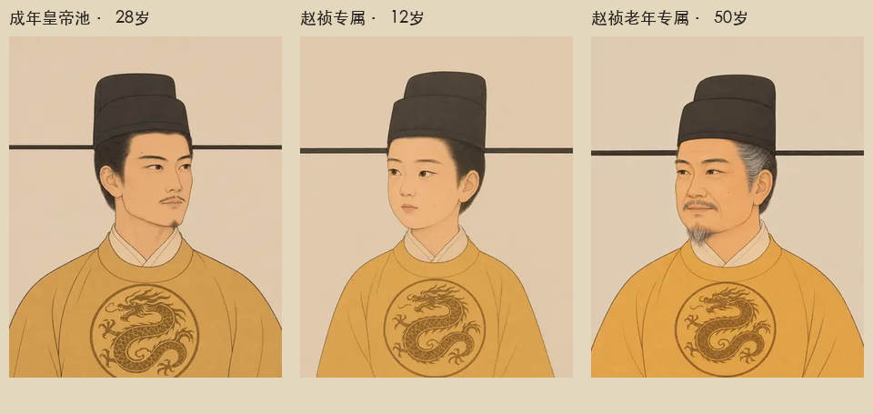

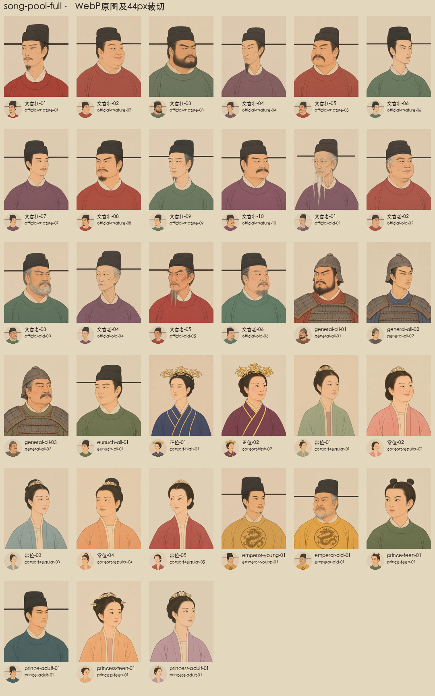

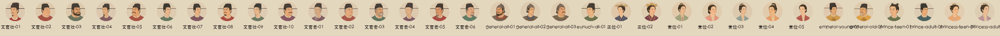

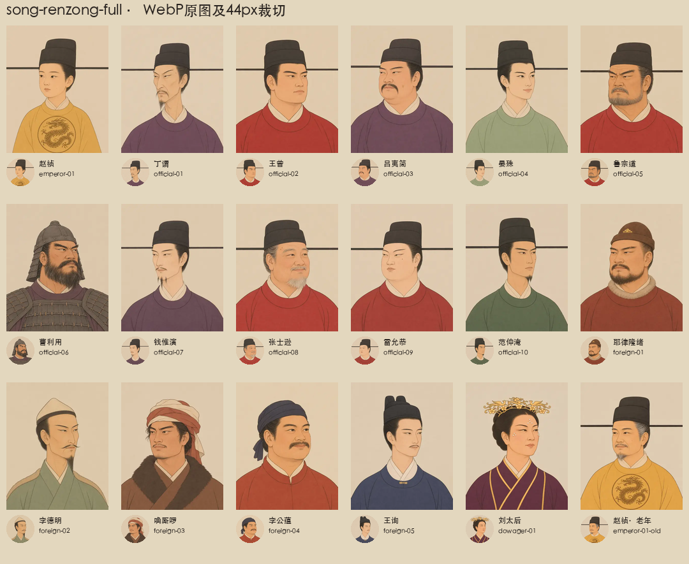

本轮完整44px人工检查未见明显撞脸；赵祯少年／老年是同一人的年龄变体。池内74对长相卡、专属不同人物152对均至少四维不同，脸型或须形／发际线不同；文字维度检查与上述实图检查结合，不以服饰或卡片字符串代替辨脸。全51张25左／26右，池16左／17右、专属9左／9右。[最终长相卡](art-phase3-song-review/final/face-cards.json)、[池卡及构图检查](art-phase3-song-review/final/asset-checks.json)、[专属卡逐对检查](art-phase3-song-review/final/unique-card-pairs.json)。

分池原尺寸44px条也存`qa/art/`，仓库镜像：

[文官壮](art-phase3-song-review/final/pools/song-official-mature-44.png) · [文官老](art-phase3-song-review/final/pools/song-official-old-44.png) · [武将](art-phase3-song-review/final/pools/song-general-all-44.png) · [宦官](art-phase3-song-review/final/pools/song-eunuch-all-44.png) · [正位](art-phase3-song-review/final/pools/song-consort-high-44.png) · [常位](art-phase3-song-review/final/pools/song-consort-regular-44.png) · [皇帝青](art-phase3-song-review/final/pools/song-emperor-young-44.png) · [皇帝老](art-phase3-song-review/final/pools/song-emperor-old-44.png) · [皇子少](art-phase3-song-review/final/pools/song-prince-teen-44.png) · [皇子成](art-phase3-song-review/final/pools/song-prince-adult-44.png) · [公主少](art-phase3-song-review/final/pools/song-princess-teen-44.png) · [公主成](art-phase3-song-review/final/pools/song-princess-adult-44.png)。

### 生成、清单和体积

全部使用内置imagegen。池图先写卡、按同池2×2出稿，尾组空格不导出；专属单张，赵祯老年另传本人少年原稿。自皇帝池按反馈修订后，每次都同时传入一期四张完整板＋更新后的宋制四张完整板；编辑另传本人目标，保留八幅参考。构图不合格稿件单独保身份校正，宽松原稿18%／42%只是中间步骤，最终导出仍严格原线。导出只裁切、等比缩放、WebP编码，不手工修脸、调色或补画。原图PNG与全部修订仅本机`art-source/phase3-song/`。

| 范围 | 实际张数 | 字节 |
| --- | ---: | ---: |
| 宋制池图 | 33 | 见逐文件记录 |
| 宋仁宗专属 | 18（17位开局人物＋赵祯老年） | 见逐文件记录 |
| 本批宋制合计 | **51** | **410,192** |
| assets/art全目录 | **337个WebP** | **4,619,464（约4.62MB）** |

全部400×500／q75，最大16,326字节，均≤30KB；完整帽冠顶10.00–14.00%，双眼36.23–39.99%，由Vision探针结合全图人工检查。总目录低于12MB。前批286个WebP与明清唐清单、场景／殿阁／焦点逐字节或逐数据项保持；三张非皇帝宋制定调样张也与d3ea61b逐字节相同。相对定调提交新增47个WebP，只替换青年皇帝池01。[完整资产／散列记录](art-phase3-song-review/final/asset-checks.json)。

宋池33槽与专属18槽全部填齐；宋仁宗**17位开局历史人物均优先取到本剧本专属像**，包括12岁皇帝、10位大臣、5位外邦、刘太后。王曾召见实际取official-02，雷允恭取official-09。清单与337个实际文件一一对应，其他朝代保持。为守原860,000字节HTML预算，清单仅折叠数据空白、每池／每个人物一行；未改取图规则或放宽预算。core、LLM、CSS、存档v25均未改。[清单及开局逐人检查](art-phase3-song-review/final/manifest-checks.json)。

### 测试、浏览器、退回与预算

**608／608测试、200年／7200旬无模型模拟、构建通过**。模拟命令`node scripts/simulate.mjs 200`，默认尽职策略，6朝、5次传承、无亡国，终局国库2040；HTML859,561字节，低于原860,000预算。既有专属取图测试增加宋仁宗，文件总数断言更新到337；没有改引擎测试门槛。[测试／模拟／构建摘要与散列](art-phase3-song-review/final/test-summary.json)。

应用内浏览器在独立`http://127.0.0.1:4215`空卷第1卷开宋仁宗试读，只查看、打开王曾召见纸面，未垂询、未推进旬、模型请求0，不接触线上或私人旧卷。开局预览、朝堂、召见均完成1280／768／390截图；实际取图与400×500加载正常。手机行动头图112px、object-fit:cover，使用audience-720，裁切不露出画面边缘；召见像桌面200×250、手机120×150。360宽scrollWidth=360，无横向溢出。

宋开局无后妃，女性池用生产palacePanel／portraitHTML／CSS的**只读投影**做三档后宫样式检查，虚构状态未写入开局或存档。另有51张完整图册，使用生产取图函数，153个纸面／卡片／圆章实例全部400×500加载，51个来源无失败。

本机QA服务仅中断WebP连接，序章章节头／朝堂殿阁头图均naturalWidth0、opacity0，名册退回44×44首字圆章，文字和导航继续可用；恢复响应后加载正常。此项是**图片断连模拟，未做整机物理断网**。设置关闭插图并刷新后，所有图片无src、场景display:none，名册仍44px；最终恢复开启，视口恢复默认。游戏及投影warn／error为空。[浏览器实测读数](art-phase3-song-review/final/browser-results.json)。

首屏预算用Lighthouse完成后独立刷新记录，1280宽宋试读卷0旬首屏共**5次图片请求／3个不同文件**，≤6。[请求明细](art-phase3-song-review/final/first-screen-budget.json)。按实际DOM前景与纸面／案面背景计算，标题、纸面正文与输入标签等最低**6.99:1**，均≥4.5；文字未直接压在插图上。[对比度读数](art-phase3-song-review/final/contrast-checks.json)。

官方Lighthouse对生产朝堂、后宫投影、召见纸面各跑1280／390，共六次，可访问性均**100**。真实交互与截图均在应用内浏览器；无头Chrome只用于官方Lighthouse审计。原始报告本机保留，仓库记录版本、时间、失败项与原报告SHA-256。[Lighthouse六次摘要](art-phase3-song-review/final/lighthouse-summary.json)。

### 三档截图

| 视口 | 真实开局 | 真实朝堂 | 真实召见 | 后妃只读投影 |
| --- | --- | --- | --- | --- |
| 1280 | [开局](art-phase3-song-review/final/opening-1280.jpg) | [朝堂](art-phase3-song-review/final/court-1280.jpg) | [召见](art-phase3-song-review/final/paper-1280.jpg) | [后妃](art-phase3-song-review/final/harem-projection-1280.jpg) |
| 768 | [开局](art-phase3-song-review/final/opening-768.jpg) | [朝堂](art-phase3-song-review/final/court-768.jpg) | [召见](art-phase3-song-review/final/paper-768.jpg) | [后妃](art-phase3-song-review/final/harem-projection-768.jpg) |
| 390 | [开局](art-phase3-song-review/final/opening-390.jpg) | [朝堂](art-phase3-song-review/final/court-390.jpg) | [召见](art-phase3-song-review/final/paper-390.jpg) | [常位](art-phase3-song-review/final/harem-projection-390.jpg)／[正位](art-phase3-song-review/final/harem-projection-high-390.jpg) |

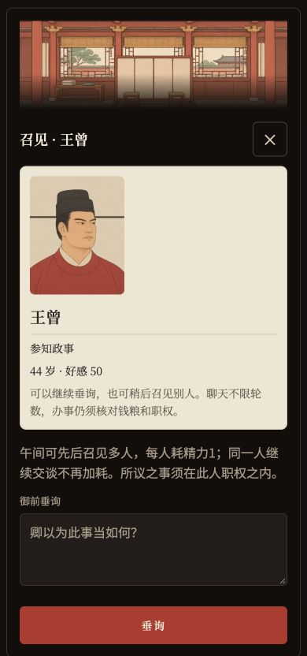

[断图序章](art-phase3-song-review/final/offline-prologue-390.jpg) · [断图朝堂](art-phase3-song-review/final/offline-court-390.jpg) · [关闭插图序章](art-phase3-song-review/final/illustrations-off-prologue-390.jpg) · [关闭插图名册](art-phase3-song-review/final/illustrations-off-court-390.jpg) · [360实际游戏](art-phase3-song-review/final/game-360.jpg) · [1280独立刷新首屏](art-phase3-song-review/final/first-screen-1280.jpg)。

Pages线上验证留待玩家批准合并发布后执行；本分支未合并、未部署，没有把本地验收称为上线。

宋制定调第1步历史（已确认；原少年皇帝池后改成年）

## 三期第二批 · 宋制定调第1步 · 2026-11-09（历史记录：已确认）

从最新main／`608a92c`新建`feat/art-phase3-song`。本步完成**4／51张**：文官壮、常位后妃、正位后妃、皇帝青各01，全部接入池图清单；**尚余47张，必须等画风确认后再生成**。仅开草稿PR，不合并、不发布。

### 四张样张与服饰辨识

| 池图 | 长相与宋制标志 |
| --- | --- |
| `song/official-mature-01` | 44岁瘦长矩形脸、细髭与短分叉颏须；绯圆领公服、无补子；黑幞头两根长硬直脚水平延伸出肩宽，端部被画框截断 |
| `song/consort-regular-01` | 24岁心形脸、柔眉圆眼、低髻小花团冠；湖绿直领对襟褙子，淡藕内衣；无珍珠面妆 |
| `song/consort-high-01` | 34岁细长菱鹅蛋脸、修长颈肩、端静神情；靛青礼服、宽敞龙凤花钗冠，额头与双颊点白珍珠妆；44px仍可见更隆重冠体 |
| `song/emperor-young-01` | 12岁男孩、小颈肩、无须，红圆领袍、长直脚幞头；先保证宋仁宗开局临时取池图时符合年龄 |

四张均为**虚构池图**。王曾和赵祯在当前预览暂取相应池位，不代表其最终专属像；18张专属像等待第2步依据剧本与史料另画，雷允恭按宦官。宋仁宗开局没有后妃、皇嗣；引擎宗室里保留的是少年赵祯本人，未改动这项原规则。

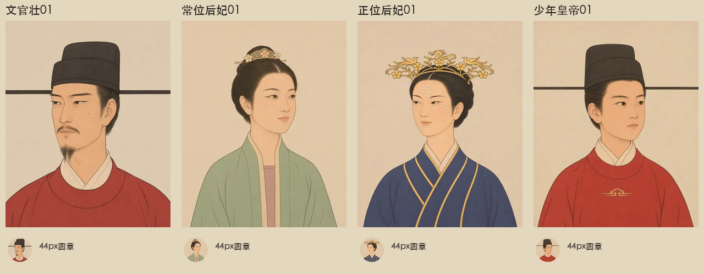

按要求拼宋、唐、明、清四朝文官。宋的长硬平直脚、唐的脑后软垂脚、明的短椭圆硬展角与补服、清的顶珠暖帽朝珠补褂分别保留；对照图下附实际44px圆章。

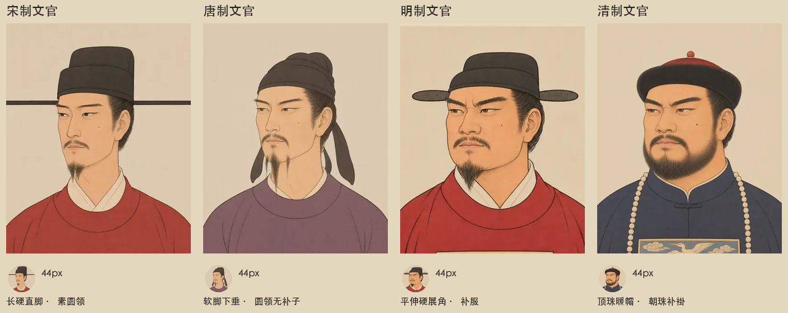

### 生成、清单与预算

- 内置imagegen逐张生成定调；初稿传一期四张完整参照板，四张宋候选出齐后，每次校正同时传一期板、宋板与目标原图。两板包含八幅完整参考，沿用前两期做法；确认后的池图按同池2×2，专属单张。长相卡、宋制共同服饰要求与全部实际提示词均先记后生成，见[ART-PROMPTS](ART-PROMPTS.md)。
- 文官初稿通过；两档后妃与皇帝在生成端保留原脸校正构图，正位再压低花钗冠上部枝梗，保留宽度、龙凤花饰、额颊珍珠。未采用构图不合格原稿。导出仅裁切、等比缩放、WebP编码，未手工修脸、调色或补画。原图PNG、候选、参照板只在本机`art-source/phase3-song/`；仓库美术资产仅四个WebP。
- `art-manifest.js`仅四个宋池的01槽由空变为路径；宋池其余29槽、宋仁宗18个专属槽继续为空，未出图不请求。其余所有池、专属、场景、殿阁、焦点与main相同。[清单比较](art-phase3-song-review/manifest-checks.json)。core、LLM、取图函数与存档v25均未改。
- 四张**400×500／q75**，帽／冠／发顶**10.00–14.00%**，双眼**36.66–39.99%**，两左两右。新增**32,166字节**，最大单张**12,422字节**，均低于30KB。assets/art共**290个WebP／4,241,438字节（约4.24MB）**，低于12MB；原有286文件逐字节相同。[构图、尺寸、散列与体积](art-phase3-song-review/asset-checks.json)、[四张长相卡](art-phase3-song-review/face-cards.json)。

### 本步验证与截图

**608／608测试、200年／7200旬无模型模拟、构建通过**；模拟6朝、5次传承、无亡国，终局国库2040。HTML858,273字节，低于860,000预算。既有清单断言只更新文件数到290，未新增重复实现的测试。[测试及模拟摘要](art-phase3-song-review/test-summary.json)。

应用内浏览器通过`npm run serve`提供的`http://127.0.0.1:4213`验收，实际第1卷空卷开宋仁宗试读，只查看开局、朝堂与设置，未推进回合、未请求模型，未接触线上或已有私人存档。开局少年皇帝、朝堂王曾均正常加载相应400×500样张；未出图角色继续显示首字。

两位后妃通过生产`portraitSource`、`portraitHTML`、`initArt`与原CSS的**只读展示页**检查纸面／人物卡／44px圆章，不把虚构人物写入开局或存档。展示页在浏览器初始化插图设置后再调用生产取图函数，开启时12个展示实例均400×500／opacity1，关闭时所有img都无src、12个实例均44×44首字圆章，随后恢复开启。它不是新增游戏页面，辅助HTML仅本机留存。

实际游戏与样张页在360宽下scrollWidth均360，390宽无横向溢出。游戏与最终展示页warn／error为空，临时视口已恢复。[浏览器读数](art-phase3-song-review/browser-results.json)。下方1280、390使用完整页面截图，不用可见视区右侧被工具截短的截图作宽度证据。

**1280档 · 生产取图与样式只读展示**

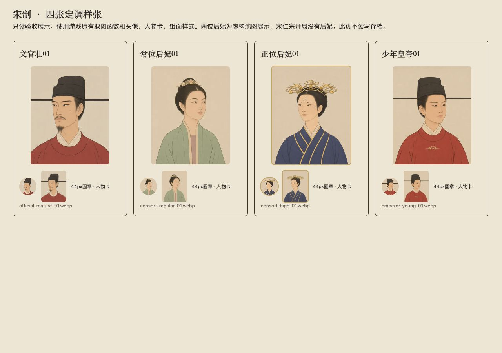

**390档 · 生产取图与样式只读展示**

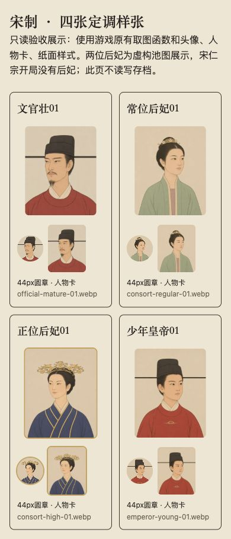

**实际开局与朝堂 · 390档**

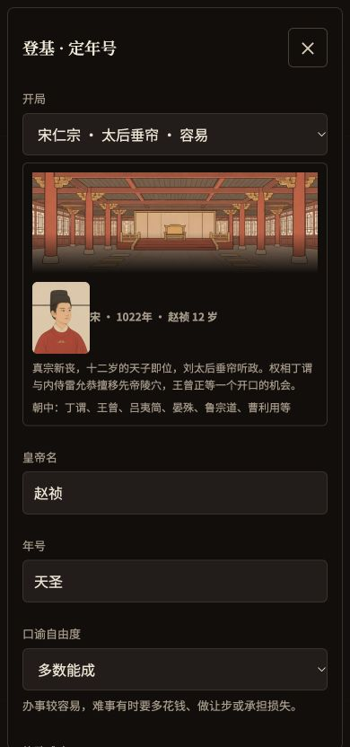

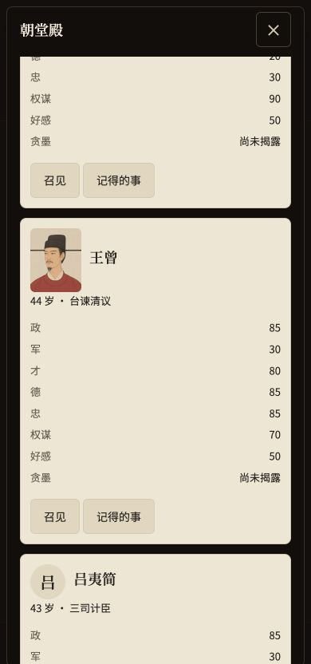

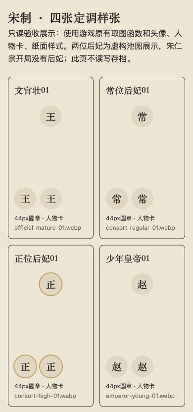

### 确认后待做

剩余**29张池图＋18张专属像＝47张**尚未生成。确认后每池先补全长相卡，同池任意两张至少4维不同且脸型／胡须不同，后妃脸格外拉开；专属卡依据scenarios.js与史料，宋仁宗17位开局人物逐一接入专属，含12岁赵祯、雷允恭及5位外邦冠服，另画赵祯老年像；少年儿童男女必须明确。

完整§9验收在批量完成后执行：全员专属取图、1280／768／390完整三档、资源断网退回、首屏请求预算、对比度与Lighthouse本步**尚未宣称通过**。本步已完成测试、200年模拟、构图体积、两档样张截图、360溢出、插图开关；未合并、未部署Pages。

---

## 三期第一批 · 唐制验收（已合并发布）

## 最终三张修订与Pages发布 · 2026-11-08

玩家通过62张后要求：皇子少年池01、李承乾幼年像去掉发带，改为男童总角或小幞头；高士廉51岁画成熟些、鬓发花白。已用内置imagegen仅替换这三张：两男童均改小型黑色软脚幞头，保留各自13／8岁原脸、眉痣与衣色；高士廉保留朝右和原宽上窄下脸型，补花白鬓须、成熟眼周与额纹，和35岁李孝恭分开。提示词与长相卡同步更新。

相对`6a92b32`恰好替换3个WebP，其他283个逐字节相同；Tang仍62张／530,882字节，全目录286个WebP／4,209,272字节。源码、HTML、取图清单、测试与存档规则不变，仍v25。[替换散列与构图](art-phase3-tang-review/revision-20261108-release/asset-checks.json)。最终全池、每池44px、唐太宗完整44px和年龄对照已在本页下方更新。

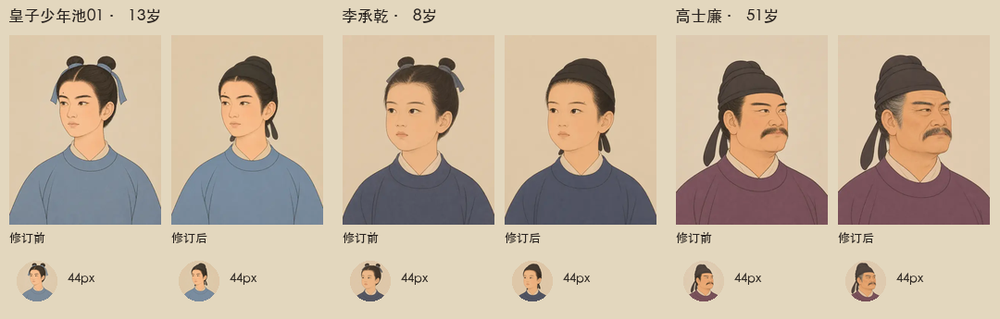

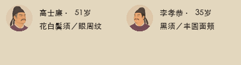

本轮608／608测试、200年／7200旬mock模拟、构建通过；最终三张导出后追加美术测试通过。应用内浏览器通过localhost真实唐局查看宗室李承乾、朝堂高士廉，1280／390图像400×500正常，360无横向溢出；生产取图只读投影124个头像／人物卡、62源全部正常显示。Lighthouse沿用完整批次六次100，本轮未重跑（HTML／CSS／源码逐字节不变）。[本轮测试摘要](art-phase3-tang-review/revision-20261108-release/test-summary.json)、[浏览器读数](art-phase3-tang-review/revision-20261108-release/local-browser-results.json)。

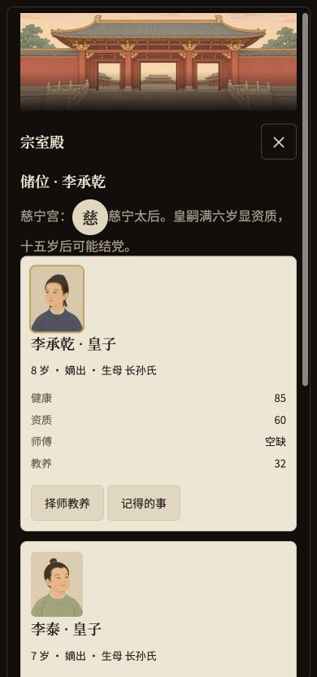

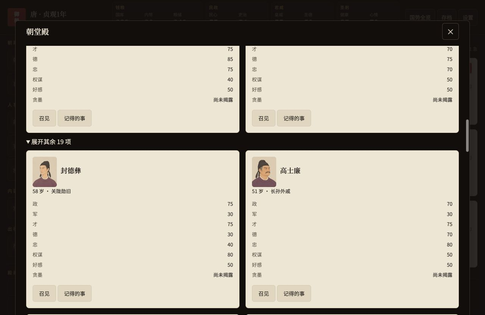

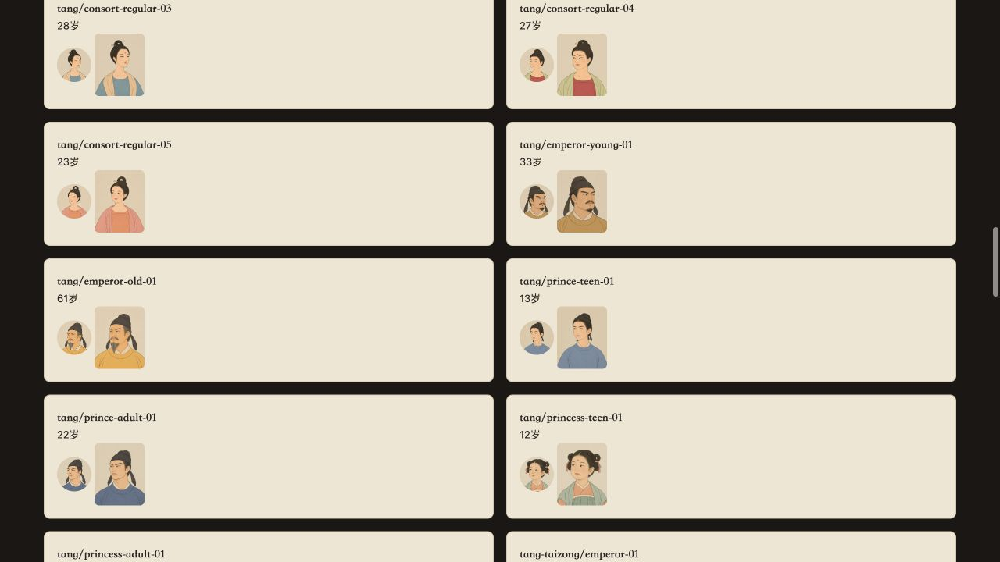

已按玩家授权合并PR #7至main，合并提交`73def5b`。[Pages测试、构建与部署运行](https://github.com/Lynch715/yuji-emperor/actions/runs/42508344139)全部成功。

发布后逐一获取正式站点HTML及286张WebP，共**287项HTTP 200且SHA-256完全匹配合并提交**。[完整线上散列](art-phase3-tang-review/revision-20261108-release/pages-all-hashes.json)。

新版应用内浏览器在正式站点的唐太宗开局预览中，确认李世民专属像400×500、opacity=1，1280／390正常，390无横向溢出；另外直接打开三张修订WebP，全部400×500成功解码。线上检查没有新建唐局，没有推进或覆盖已有游戏；真实宗室／朝堂人物卡在隔离localhost复验，范围与正式站点预览分开记录。[线上浏览器读数](art-phase3-tang-review/revision-20261108-release/live-browser-results.json)。

既有第3卷万历0旬在发布前后通过正常导出取得，**38,163字节逐字节相同**，SHA-256均为`44fa7e68aac173da77068995b5e17b4baed065966d58d56604e0ce5bc1da4d82`；第1／2卷仍为空卷，插图设置未改变。原始存档仅留本机未提交。[存档保持证据](art-phase3-tang-review/revision-20261108-release/save-preservation.json)。

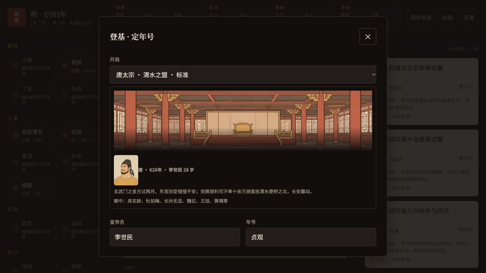

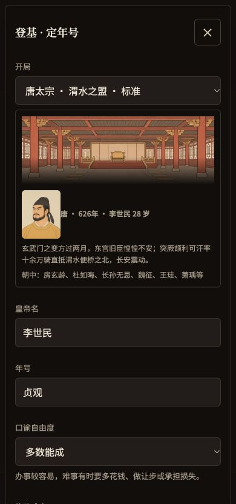

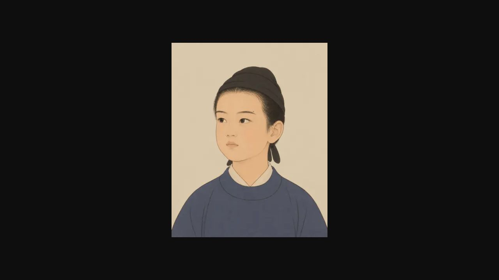

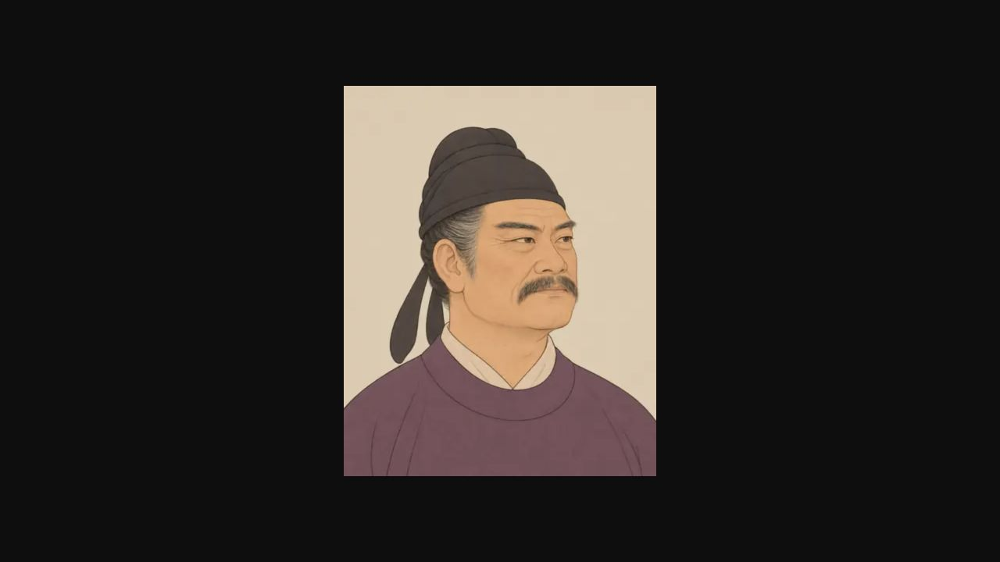

## 全批完成 · 2026-11-08

玩家已确认唐制画风，本轮完成其余58张，并重出正位池01：更高、更大的纵向高髻，凤钗与三串垂珠；44px仍明显隆重于常位。当前唐制**62／62**，[PR #7](https://github.com/Lynch715/yuji-emperor/pull/7)已获玩家批准；本段记录完整批次验收，最终修订与发布进度见本页首节。

分支`feat/art-phase3-tang`；主线基准`97f80a4`，定调样张基准`79bace9`。原工作区未提交内容保留。全部素材使用内置imagegen；一期四张与更新后的唐制四张以两块完整参照板随每次生成传入，未减少参考画面。池图先写卡再按2×2出稿，尾组空格不导出；专属像单张，年龄变体另加本人底像。构图不合格的稿件在生成端保留原脸校正，未接入未合格原稿。实际提示词、史料索引、脸卡及修订过程见[ART-PROMPTS](ART-PROMPTS.md)。原始PNG与失败稿仅留本机`art-source/phase3-tang/bulk/`。

### 数量、体积与兼容

| 范围 | 张数 | WebP字节 |
| --- | ---: | ---: |
| 唐制池：文官壮10、老6、武将3、宦官1、正位2、常位5、皇帝青老各1、皇子少成各1、公主少成各1 | 33 | 299,602 |
| 唐太宗专属：25位历史开局人物＋李世民老年＋李承乾／李泰／李恪成年 | 29 | 231,280 |
| 本批唐制合计 | **62** | **530,882** |
| `assets/art/`全目录 | **286个WebP** | **4,209,272（约4.21 MB）** |

全部唐像400×500、WebP q75，最大16,378字节，低于每张30 KB；总目录低于12 MB。逐张导出记录的完整髻／帽顶距为10–14%，眼高为36.02–40%；构图探针与全图人工复检结合。前两期224个WebP逐字节保持，唐制其余三个已确认定调样张逐字节保持，仅正位01按反馈替换。[资产及构图记录](art-phase3-tang-review/final/asset-checks.json)。

仅填唐制33池槽和唐太宗29专属槽，其他朝代、其他剧本、共用池、场景／殿阁、焦点配置逐项比对不变。`src/core`没有修改，存档仍v25；既有脸号、随机数、迁移与提交规则保持。[保持性核对](art-phase3-tang-review/final/preservation.json)。

### 长相、44px与年龄复检

同池长相卡74组两两组合均至少四维不同，脸型或胡须／发际线维度不同；最终全图与44px逐池检查。唐制软脚下垂、圆领无补子、文武区别以及后妃两档头饰继续沿用已确认规范。正位01保留原脸与衣色，只加强高髻、凤钗、垂珠：

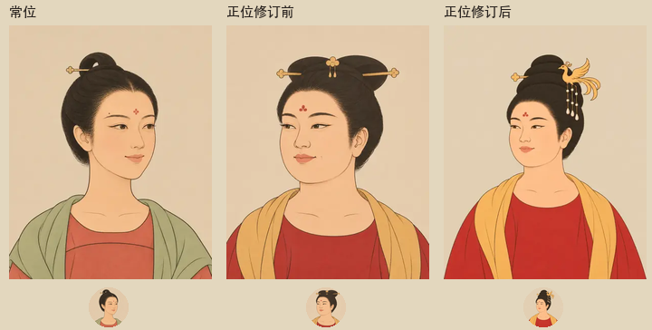

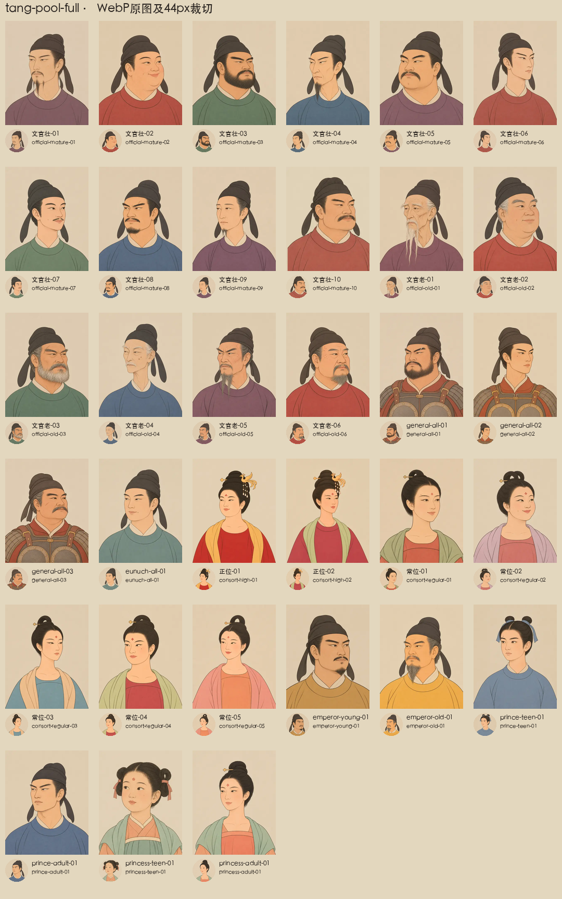

逐池44px条也保存在本机`qa/art/`，仓库镜像：[文官壮](art-phase3-tang-review/final/pools-44/tang-official-mature-44.png)、[文官老](art-phase3-tang-review/final/pools-44/tang-official-old-44.png)、[武将](art-phase3-tang-review/final/pools-44/tang-general-all-44.png)、[宦官](art-phase3-tang-review/final/pools-44/tang-eunuch-all-44.png)、[正位](art-phase3-tang-review/final/pools-44/tang-consort-high-44.png)、[常位](art-phase3-tang-review/final/pools-44/tang-consort-regular-44.png)、[皇帝青](art-phase3-tang-review/final/pools-44/tang-emperor-young-44.png)、[皇帝老](art-phase3-tang-review/final/pools-44/tang-emperor-old-44.png)、[皇子少](art-phase3-tang-review/final/pools-44/tang-prince-teen-44.png)、[皇子成](art-phase3-tang-review/final/pools-44/tang-prince-adult-44.png)、[公主少](art-phase3-tang-review/final/pools-44/tang-princess-teen-44.png)、[公主成](art-phase3-tang-review/final/pools-44/tang-princess-adult-44.png)。

专属像依据scenarios.js的年龄、性格与秘密，并参考《旧唐书》相关卷目及韦贵妃墓志；未有可靠记载的具体五官、痣和体态明确作为创作设定，外邦绘制年龄不写入游戏状态。用长短脸、全须／三绺／短颏／无须、胖瘦颈肩与神情区分；外邦冠服各异。李恪幼年稿在复检时改回明确7岁儿童比例。李世民老年为约50岁，三位皇子成年为约20岁，分别保留本人五官特征。

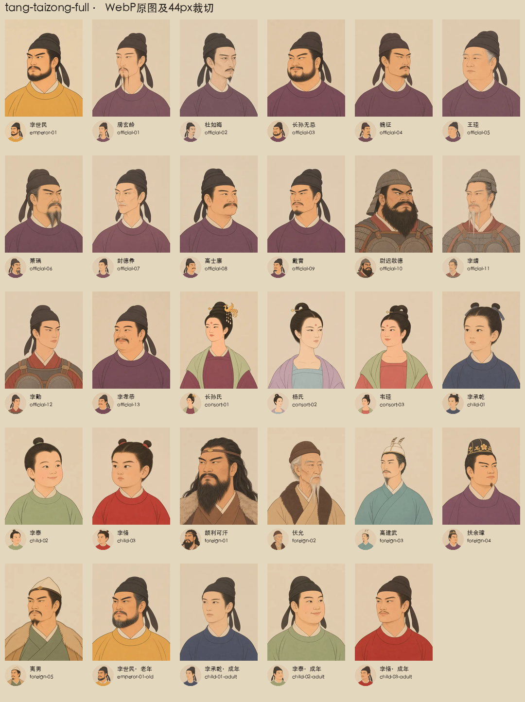

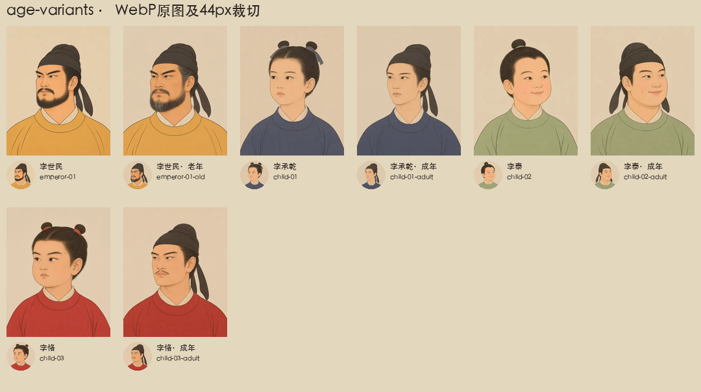

### 自动检查与应用内浏览器

- `npm test`：**608／608通过**。扩展现有测试覆盖唐、明、清五剧本全部历史开局人物，皇帝39／40切档、跨剧本同名隔离；唐清五位皇子6／7／15／16／20岁切档且取图不修改存档。
- `node scripts/simulate.mjs 200`：**200年／7200旬**，五次继位，未崩盘，最终国库2040；mock路径不请求模型。
- `npm run build`：`index.html` **858,090字节**，低于860,000预算。[测试与模拟摘要](art-phase3-tang-review/final/test-summary.json)。
- 新版Codex In-app Browser，经`http://127.0.0.1:4211`查看独立第1卷试读唐局；仅查看和打开召见预览，没有垂询模型或推进旬，没有访问线上存档。真实游戏1280×900、768×1024、390×844截图齐全，360×800无横向溢出，360时后宫弹窗scrollWidth／clientWidth均342。
- 真实召见纸面头像400×500正常；390行动头图为340×112，使用720档、object-fit:cover，完整覆盖无画边。首屏仅**3个**新增图片请求（章节、杜如晦、池文官09），不超过6。[首屏请求记录](art-phase3-tang-review/final/first-screen-requests.json)。
- 生产取图函数逐一核对62个路径；只读投影页复用生产头像HTML与CSS，初始化加载监听后再挂载，124个头像／人物卡、62个不同源均400×500解码且opacity=1。此投影页为全批解码与44px补充验证，不等同于真实游戏操作截图。[取图记录](art-phase3-tang-review/final/portrait-resolution.json)、[浏览器解码记录](art-phase3-tang-review/final/gallery-load-results.json)。

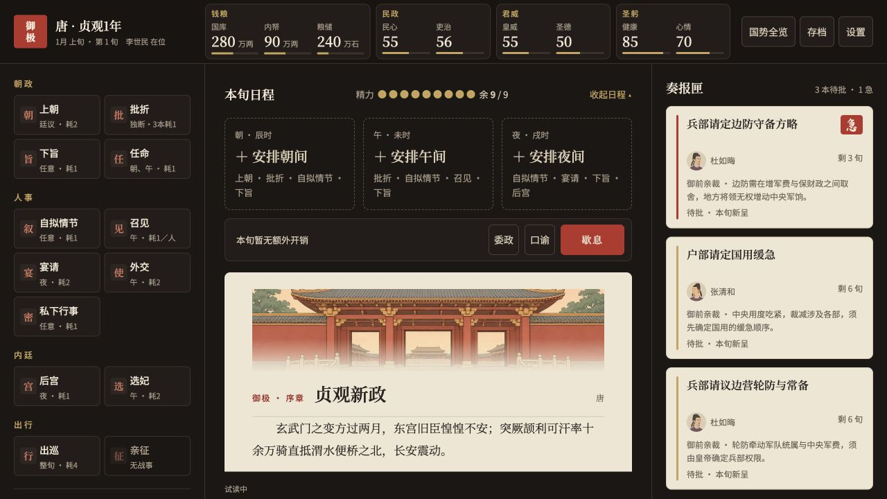

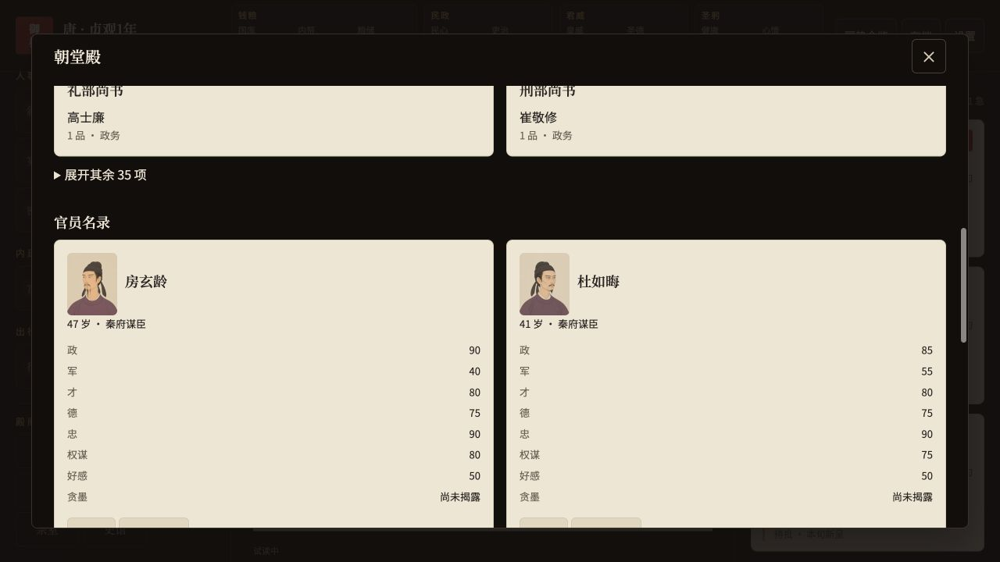

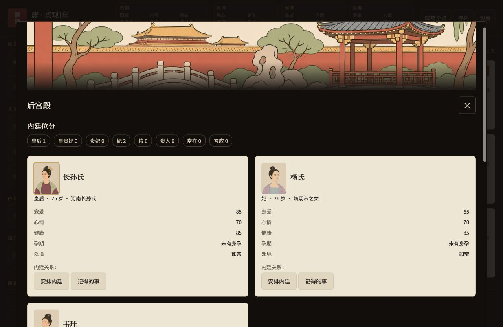

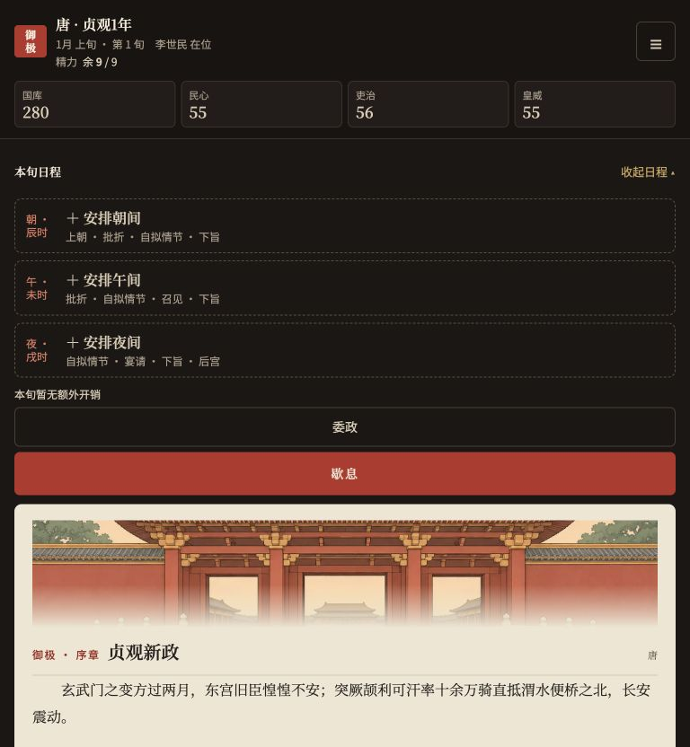

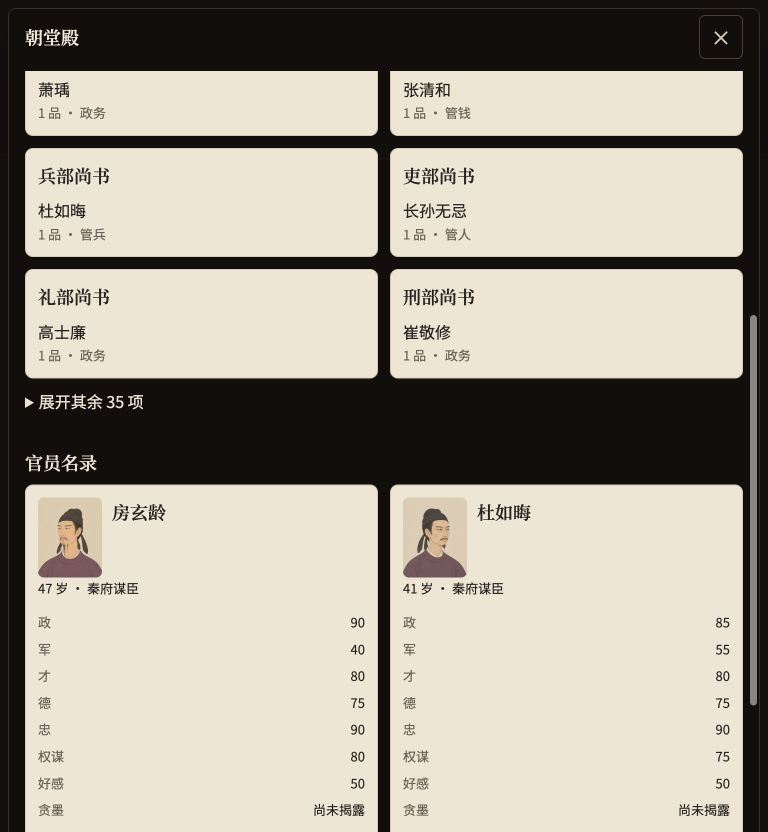

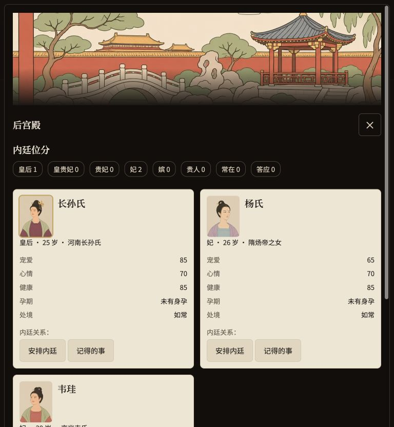

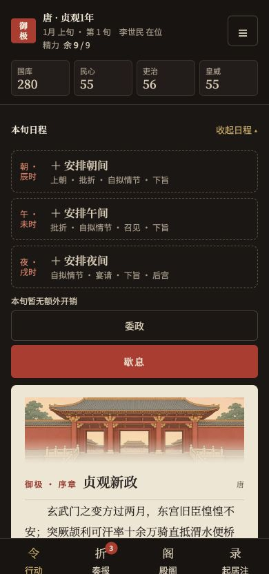

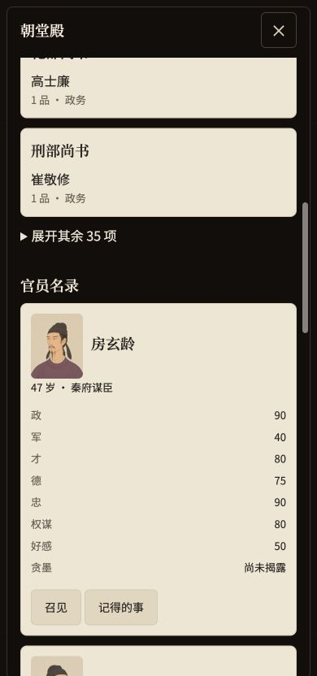

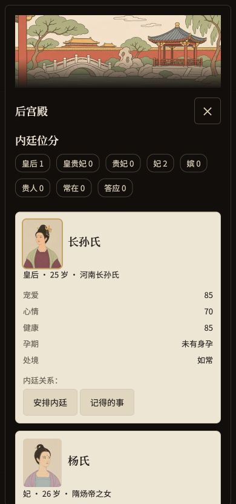

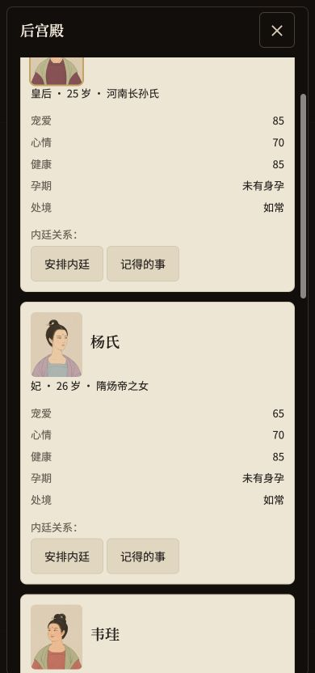

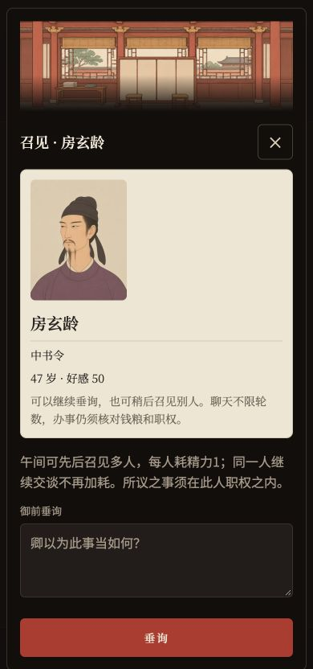

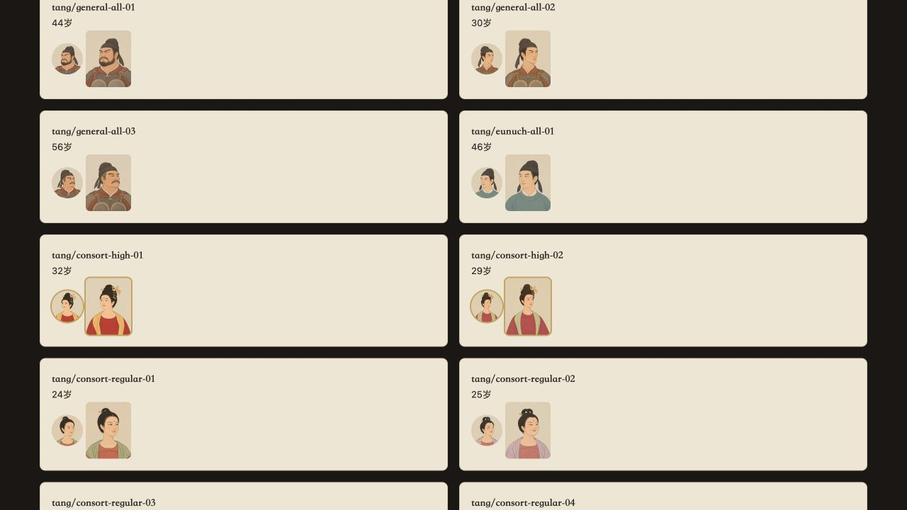

### 退回、对比度与Lighthouse

关闭「显示插图」后，img src为0、场景隐藏，人物退回44px首字圆章；刷新后仍关闭，复验后恢复开启。通过隔离localhost服务器中断所有WebP连接来模拟图片不可达，章节退回#EFE6D3纯色，人物naturalWidth=0时均标记art-failed并退回首字圆章，文字与导航仍可用；恢复连接后图片正常。此项是资源断网模拟，不宣称整机物理断网。正常与断图期间捕获的warn/error均为空。[浏览器读数](art-phase3-tang-review/final/browser-results.json)。

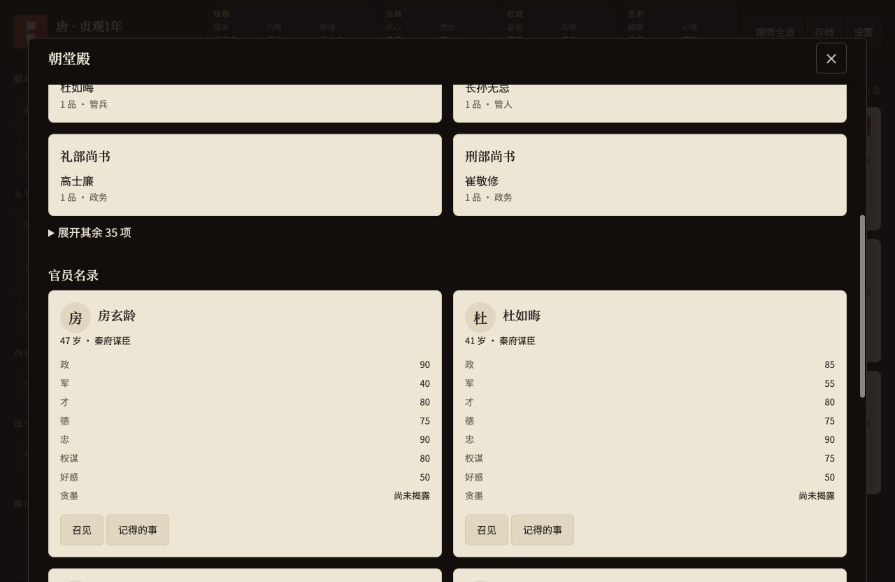

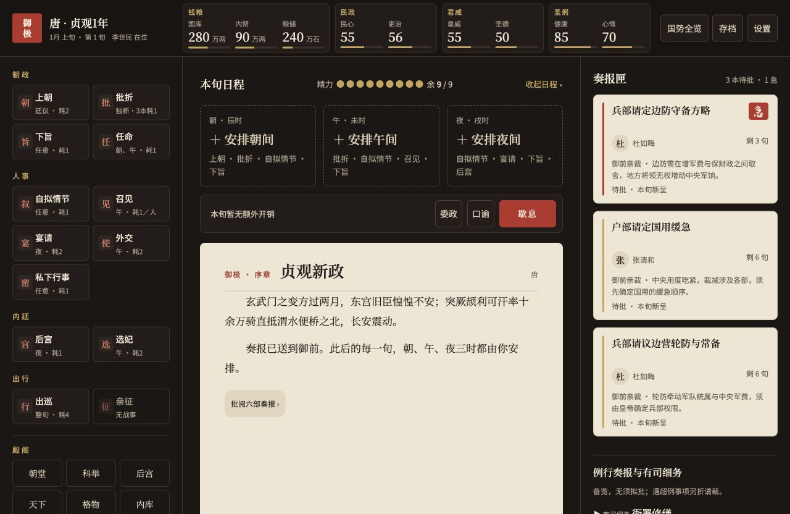

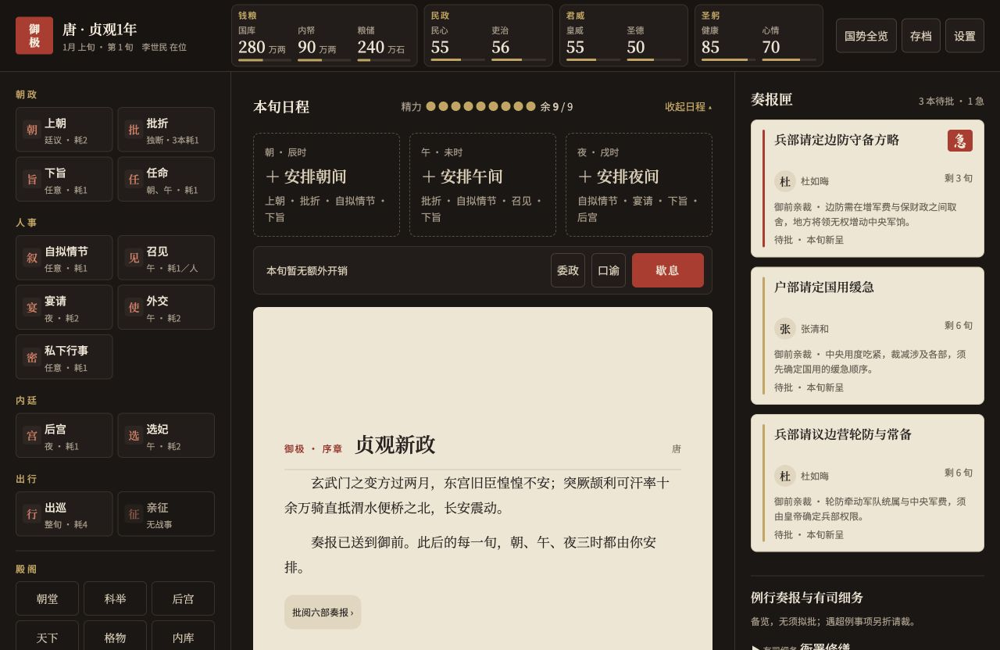

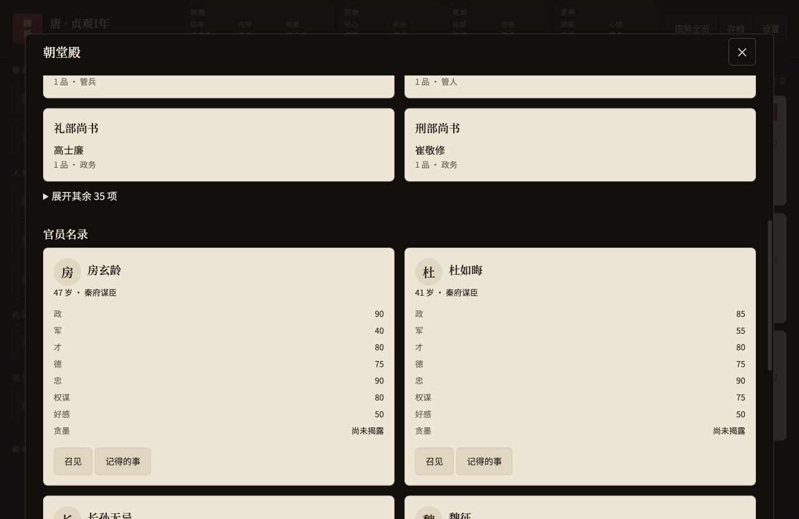

场景渐变包装不含文字，标题位于图外；实际读取当前CSS并计算美术相邻的纸面、暗底与圆章文字组合，最低**4.8314:1**，满足普通文字4.5门槛，不宣称覆盖站内任意颜色组合。[对比度记录](art-phase3-tang-review/final/contrast.json)。

官方Lighthouse使用生产朝堂、后宫与召见纸面HTML／CSS的只读投影，1280／390各三页共六次，可访问性均**100**。修正验收页早于监听器加载的静态图片时序后，六次已重新完整运行；原始报告留本机，仓库保留版本、时间、失败项与SHA-256摘要。真实交互和截图均使用应用内浏览器，Lighthouse的无头Chrome仅用于该审计。[Lighthouse摘要](art-phase3-tang-review/final/lighthouse-summary.json)。

完整批次初验时未发布Pages；玩家现已授权最终修订后合并发布，线上验证见本页首节。

历史：第1步定调样张与当时的待办（现已获确认并完成）

日期：2026-11-07。分支`feat/art-phase3-tang`，从最新main／`97f80a4`建立；原工作区的未提交内容保留。本轮**只完成第1步四张定调样张，停下等待画风确认**。唐制总范围62张（池33＋唐太宗专属29），已出池图4张，其余58张尚未生成。草稿PR仅供审阅，不合并、不发布。

## 四张样张与朝代辨识

| 文件 | 长相与服饰要件 |
| --- | --- |
| `tang/official-mature-01` | 42岁虚构池图，瘦长三角脸、三绺细髯、沉思神情；紫色圆领袍、软脚幞头，两脚向脑后下垂，胸前无补子 |
| `tang/consort-regular-01` | 24岁虚构池图，心形脸、细颈、温柔眉眼；较小高环髻、花钿、珊瑚色襦裙与石绿披帛 |
| `tang/consort-high-01` | 32岁虚构池图，丰满宽鹅蛋脸、丰润体态、沉静仪态；较大宽双环髻、步摇金钗、花钿、朱色襦裙与赭金披帛 |
| `tang/emperor-young-01` | 33岁虚构池图，宽五角脸、浓短髭与短颏须、警醒神情；赭黄圆领袍、软脚幞头 |

四张均为池图，不是截图中历史人物的专属面貌。当前唐太宗剧本按原取图规则暂用这些池图或首字圆章；29张专属像待画风确认后，依据scenarios.js与史料另写长相卡。本轮只写四张样张长相卡，各池余卡在该池开始前补齐。

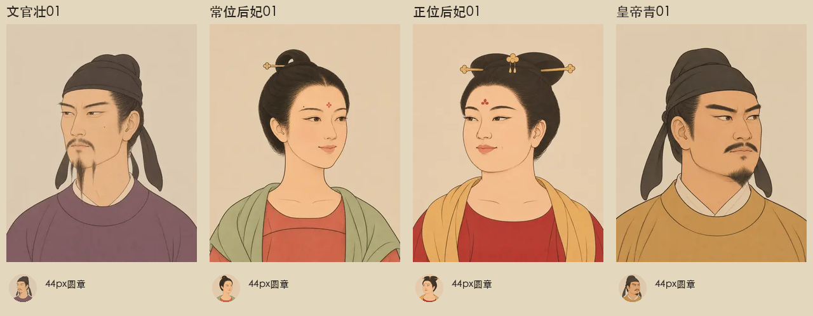

按用户要求将唐、明、清文官各一张并排，附实际44px圆章：唐为下垂软脚和无补子圆领，明为平伸硬展角与补服，清为顶珠暖帽、朝珠补褂。没有生成宋制人物；后续唐制共同约束继续禁止宋式长平硬脚。

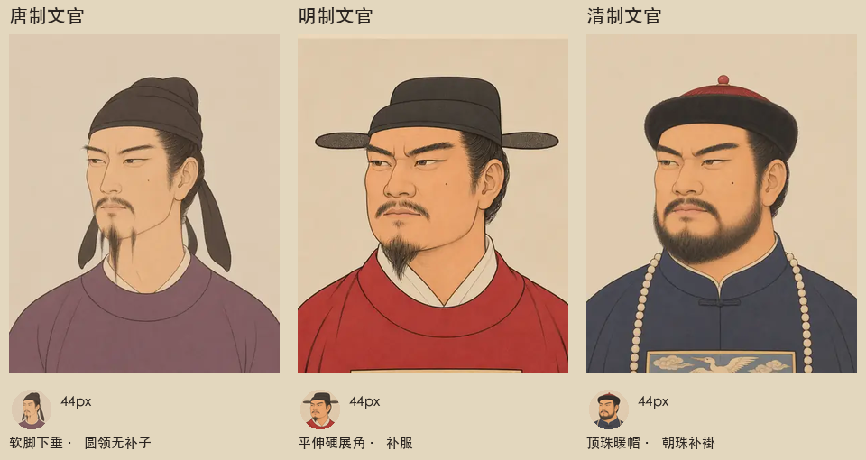

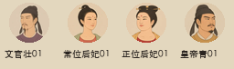

## 生成与接入

- 全部使用内置imagegen。每次初稿显式传入已批准的一期四张（明壮官01、明常位01、desk-night、court），仅参考画风。四张唐制出齐后已保存本机唐制参照板；确认后每次同时传入一期四张板＋唐四张板，八张画面全部保留，编辑时另传目标，沿用二期的参照方式。
- 按前两期定调做法逐张生成。两位后妃初稿髻顶偏高，在生成端修正上部发髻与眼位后再导出；正位第二次只压紧发髻上部，保留面貌、步摇、金钗和衣色。所有长相卡、实际提示词及修订原因已先记入[ART-PROMPTS](ART-PROMPTS.md)。后续池图按同池2×2、专属像按单张生成。
- 导出仅裁切、等比缩放和WebP转换，无手工修脸、调色或补画。原始PNG、未选稿、参照板保留本机`art-source/phase3-tang`，不提交生成原图；仓库美术资产只新增四个WebP。此页的带标签拼图与浏览器截图是验收证据。
- `art-manifest.js`仅填四个唐池的第01槽，其余64个池键、全部专属映射、场景／殿阁／焦点与97f80a4一致；未出图槽位继续为空。[清单比对](art-phase3-tang-review/manifest-checks.json)。没有改取图函数、core、LLM或存档，仍v25。
- 四张均**400×500／q75／≤30KB**；帽／发顶10.00–12.55%，双眼37.38–39.82%，朝向两左两右。新增**34,534字节**，最大单张9,678字节；assets/art共**228个WebP／3,712,924字节**，原一期、二期224个文件逐字节一致。[构图、尺寸、散列和体积](art-phase3-tang-review/asset-checks.json)、[长相卡](art-phase3-tang-review/face-cards.json)。

## 本步验证

**608／608测试、200年／7200旬mock模拟、构建通过**。模拟6朝、5次传承、无亡国，终局国库2040；HTML855,190字节，在860,000字节预算内。仅更新既有清单文件数断言到228，没有新增与画面实现同义的单元测试。[测试与模拟摘要](art-phase3-tang-review/test-summary.json)。

应用内浏览器经`http://127.0.0.1:4211`新建独立第1卷试读局，分别查看开局、朝堂和后宫。皇帝、文官、两档后妃样张均按生产取图规则正常加载为400×500。1280／390截图已保存，360宽scrollWidth=360，无横向溢出。390场景使用720档。仅查看，没有推进旬或请求模型；不接触线上存档。读取中折叠区／屏外懒加载副本可能尚未complete，不计为图片错误；可见样张均已实看。

关闭「显示插图」后，人物退回首字圆章、场景隐藏且无图片src；随后已恢复开启。浏览器warn/error为空，视口已恢复默认。[浏览器读数](art-phase3-tang-review/browser-results.json)。

### 1280档

### 390档

## 确认后待做

本步停在定调样张，未开展其余58张。确认后先补每池长相卡，再出其余池图29张与唐太宗专属29张（25位开局人物、李世民老年像、李承乾／李泰／李恪成年像）。每池、同剧本均做44px全条检查。

完整§9验收在批量完成后执行：唐剧本开局全员专属取图、完整1280／768／390三档、断网退回、首屏请求预算、对比度与Lighthouse均尚未在本批宣称通过；本步已完成的测试、模拟、体积、两档截图、360溢出和插图开关结果如上。分支阶段不做Pages线上发布验收。

